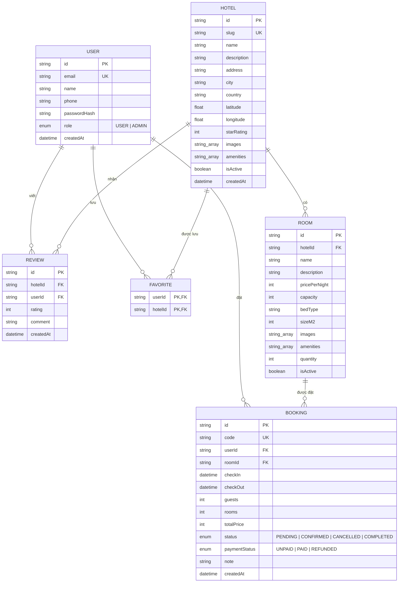

# Không Gian Số Stay – Hệ thống đặt phòng khách sạn

Đồ án thực tập tốt nghiệp tại **Công ty phần mềm Không Gian Số**. Ứng dụng web cho phép khách tìm kiếm khách sạn, đặt phòng, thanh toán (giả lập), đánh giá; quản trị viên quản lý khách sạn, phòng, đơn đặt phòng và người dùng.

## 1. Công nghệ

| Thành phần | Công nghệ |
|---|---|
| Giao diện + máy chủ | Next.js 16 (App Router, Cache Components), React 19, TypeScript |
| Giao diện | Tailwind CSS 4, lucide-react, font Be Vietnam Pro |
| Cơ sở dữ liệu | PostgreSQL 16 + Prisma ORM 6 |
| Xác thực | next-auth v5 (Credentials, phiên JWT), mật khẩu băm bcrypt |
| Kiểm tra dữ liệu | Zod |

> Dự án dùng phiên bản Next.js mới có khác biệt so với tài liệu cũ. Tài liệu đi kèm nằm trong `web/node_modules/next/dist/docs/` (xem `web/AGENTS.md`).

## 2. Chức năng

**Khách hàng**
- Trang chủ có ô tìm kiếm (điểm đến, ngày nhận/trả phòng, số khách), điểm đến phổ biến, khách sạn nổi bật.
- Trang kết quả `/hotels`: lọc theo thành phố, số khách, ngày trống; sắp xếp theo đề xuất / giá / đánh giá.
- Trang chi tiết khách sạn: thư viện ảnh, tiện nghi, danh sách phòng kèm số phòng còn trống theo ngày chọn, đánh giá.
- Đăng ký, đăng nhập, đăng xuất; trang tài khoản.
- Đặt phòng → thanh toán giả lập → xác nhận; xem lịch sử, hủy đơn (trước ngày nhận phòng).
- Yêu thích khách sạn (nút tim trên thẻ và trang chi tiết, trang `/favorites`).
- Viết hoặc sửa đánh giá sau khi đã hoàn tất kỳ lưu trú.

**Quản trị viên** (`/admin`)
- Tổng quan: số liệu, doanh thu đã thu, đơn gần đây.
- Khách sạn: thêm, sửa, ẩn/hiện; loại phòng: thêm, sửa, ẩn/hiện.
- Đơn đặt phòng: lọc theo trạng thái, đổi trạng thái theo quy tắc.
- Người dùng: xem danh sách, cấp/thu hồi quyền quản trị.

## 3. Cài đặt và chạy

### 3.1. Yêu cầu
- Node.js **20.16 trở lên** và npm
- PostgreSQL 14 trở lên (cài sẵn trên máy **hoặc** dùng Docker Desktop)

### 3.2. Lấy mã nguồn và cài thư viện
```bash
cd web
npm install
```

### 3.3. Chuẩn bị cơ sở dữ liệu

**Cách A – dùng PostgreSQL có sẵn trên máy:** không cần tạo trước database `kgs_booking`, Prisma sẽ tự tạo khi migrate nếu tài khoản có quyền tạo database.

**Cách B – dùng Docker:** chạy ở thư mục gốc dự án (cùng cấp với `docker-compose.yml`), cần bật Docker Desktop trước.
```bash
docker compose up -d
```
Cách này tạo PostgreSQL ở cổng 5432 với tài khoản `kgs`. Nếu máy đã có PostgreSQL khác dùng cổng 5432 thì hãy tắt nó hoặc đổi cổng trong `docker-compose.yml` và `DATABASE_URL`.

### 3.4. Cấu hình biến môi trường
Sao chép `web/.env.example` thành `web/.env` rồi sửa:

| Biến | Ý nghĩa |
|---|---|
| `DATABASE_URL` | Chuỗi kết nối PostgreSQL. Mật khẩu có ký tự đặc biệt phải mã hóa URL (ví dụ `@` thành `%40`). |
| `AUTH_SECRET` | Khóa ký phiên đăng nhập. Tạo khóa mạnh bằng `npx auth secret` hoặc `openssl rand -base64 32`. |
| `AUTH_TRUST_HOST` | Đặt `true` khi chạy trên máy cục bộ ở chế độ production. |

File `.env` không được đưa lên git.

### 3.5. Tạo bảng và dữ liệu mẫu
```bash
npx prisma migrate dev
npx prisma db seed
```
Lệnh seed **xóa toàn bộ dữ liệu cũ** rồi tạo lại: 2 tài khoản, 9 khách sạn ở 6 thành phố, 27 loại phòng, 9 đánh giá mẫu.

### 3.6. Chạy ứng dụng
```bash
npm run dev          # phát triển, http://localhost:3000
```
hoặc bản production:
```bash
npm run build
npm start            # http://localhost:3000
```
> Không chạy `npm run dev` và `npm start` cùng lúc trong một thư mục: cả hai dùng chung thư mục `.next` và sẽ làm hỏng nhau (trang mất JavaScript, báo lỗi 404 các tệp tĩnh). Nếu bị, hãy tắt cả hai, xóa thư mục `web/.next` rồi build lại.

## 4. Tài khoản mẫu (chỉ dùng khi phát triển)

| Vai trò | Email | Mật khẩu |
|---|---|---|
| Quản trị viên | `admin@khongiansos.vn` | `Admin@123456` |
| Khách hàng | `khach@khongiansos.vn` | `Khach@123456` |

Các tài khoản này được khai báo ở `web/prisma/seed.ts`. **Phải đổi hoặc xóa trước khi triển khai thật.**

Để thử viết đánh giá bằng tài khoản khách: đặt một phòng, thanh toán, đăng nhập admin rồi chuyển đơn sang **Hoàn tất** tại `/admin/bookings` (chỉ chuyển được từ ngày nhận phòng trở đi, nên hãy chọn ngày nhận phòng là hôm nay).

## 5. Sơ đồ cơ sở dữ liệu



Ghi chú:
- `REVIEW` có ràng buộc duy nhất `(hotelId, userId)`: mỗi khách chỉ có một đánh giá cho một khách sạn.
- `FAVORITE` dùng khóa chính kép `(userId, hotelId)`.
- Xóa khách sạn sẽ xóa theo phòng, đánh giá, yêu thích (`onDelete: Cascade`). Đơn đặt phòng không bị xóa theo nên giao diện quản trị chỉ **ẩn** khách sạn, không xóa.
- Giá lưu theo đơn vị đồng (số nguyên), ngày nhận/trả phòng lưu ở dạng ngày UTC.

Có thể xem sơ đồ bằng VS Code (tiện ích Markdown Preview Mermaid Support), GitHub, hoặc dán khối `mermaid` vào <https://mermaid.live> để xuất ảnh đưa vào báo cáo.

## 6. Quy tắc nghiệp vụ chính

**Đặt phòng**
- Giá luôn được tính lại ở máy chủ (`đơn giá × số đêm × số phòng`), không tin giá từ trình duyệt.
- Thời gian ở từ 1 đến 30 đêm; ngày nhận phòng không được ở quá khứ; số khách không vượt `sức chứa × số phòng`.
- Kiểm tra phòng trống và tạo đơn trong **một giao dịch mức Serializable** để hai người đặt cùng lúc không vượt quá số phòng hiện có.
- Đơn mới ở trạng thái **Chờ thanh toán** và **giữ phòng 30 phút**; quá hạn mà chưa thanh toán thì không còn giữ phòng và không thanh toán được nữa.
- Thanh toán là **giả lập**: không thu tiền thật, không nhận thông tin thẻ; chỉ chọn phương thức rồi đơn chuyển sang Đã xác nhận / Đã thanh toán.
- Khách hủy đơn trước ngày nhận phòng; đơn đã thanh toán được đánh dấu **Đã hoàn tiền**.

**Quản trị đơn đặt phòng** – chuyển trạng thái một chiều:

| Từ | Được chuyển sang |
|---|---|
| Chờ thanh toán | Đã xác nhận (đánh dấu đã nhận tiền), Đã hủy |
| Đã xác nhận | Hoàn tất (từ ngày nhận phòng trở đi), Đã hủy |
| Đã hủy, Hoàn tất | không chuyển tiếp |

Khi xác nhận một đơn chờ đã quá hạn giữ phòng, hệ thống kiểm tra lại còn phòng hay không.

**Đánh giá**: chỉ khách có đơn **Hoàn tất** tại khách sạn đó mới được viết; gửi lại sẽ cập nhật đánh giá cũ. Điểm trung bình tính từ các đánh giá.

## 7. Bảo mật

- Mật khẩu băm bcrypt; đăng nhập so sánh trong thời gian không phụ thuộc việc email có tồn tại.
- Phiên là JWT mã hóa trong cookie; vai trò kiểm tra **ở từng trang và từng hành động quản trị** (`requireAdmin`), không chỉ dựa vào layout hay giao diện.
- Đường dẫn quay lại sau đăng nhập (`callbackUrl`) chỉ chấp nhận đường dẫn nội bộ, tránh chuyển hướng ra ngoài.
- Ảnh do quản trị nhập chỉ chấp nhận `https` từ `picsum.photos` và `images.unsplash.com` (khai báo ở `src/lib/image-hosts.ts`).
- Quản trị viên không đổi được vai trò của chính mình, tránh tự khóa quyền.
- Mọi dữ liệu nhập đều kiểm tra bằng Zod ở máy chủ.

## 8. Cấu trúc thư mục

```
Booking_Hotel/
├─ docker-compose.yml        PostgreSQL cho môi trường phát triển
└─ web/
   ├─ prisma/
   │  ├─ schema.prisma       mô hình dữ liệu
   │  ├─ migrations/         lịch sử migrate
   │  └─ seed.ts             dữ liệu mẫu
   └─ src/
      ├─ auth.ts             cấu hình next-auth
      ├─ app/
      │  ├─ page.tsx         trang chủ
      │  ├─ hotels/          tìm kiếm và chi tiết khách sạn
      │  ├─ book/            xác nhận đặt phòng
      │  ├─ bookings/        lịch sử, chi tiết, thanh toán
      │  ├─ favorites/       khách sạn yêu thích
      │  ├─ login/, register/, account/
      │  ├─ admin/           khu vực quản trị
      │  ├─ api/             next-auth và danh sách yêu thích
      │  └─ actions/         Server Actions (auth, booking, engage, admin)
      ├─ components/         thành phần giao diện (admin/ cho quản trị)
      └─ lib/                truy vấn, quy tắc đặt phòng, phiên, định dạng
```

## 9. Hạn chế và hướng phát triển

- Thanh toán chỉ giả lập; có thể tích hợp cổng VNPay hoặc MoMo (chế độ sandbox).
- Ảnh khách sạn mẫu là ảnh ngẫu nhiên từ picsum.photos, chưa phải ảnh thật; chưa có chức năng tải ảnh lên.
- Chưa gửi email xác nhận, chưa có bản đồ, chưa giới hạn số lần đăng nhập sai.
- Chưa có ứng dụng di động (dự kiến React Native/Expo dùng chung API).
- Chưa có kiểm thử tự động; các luồng chính đã được kiểm tra thủ công.
- Trước khi triển khai thật: đổi `AUTH_SECRET`, xóa tài khoản mẫu, dùng HTTPS và PostgreSQL riêng có sao lưu.
