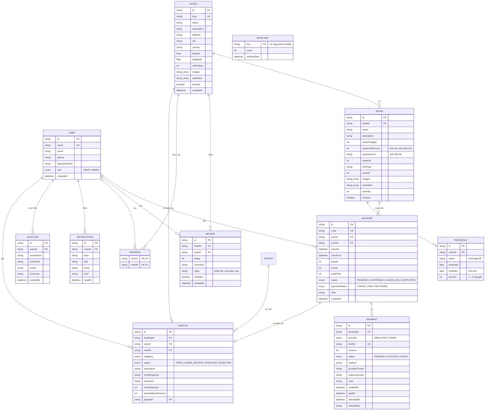

# Không Gian Số Stay – Hệ thống đặt phòng khách sạn

Đồ án thực tập tốt nghiệp tại **Công ty phần mềm Không Gian Số**. Ứng dụng web cho phép khách tìm kiếm khách sạn, đặt phòng, thanh toán (giả lập), đánh giá; quản trị viên quản lý khách sạn, phòng, đơn đặt phòng và người dùng.

> Sơ đồ cho báo cáo (use case, tuần tự đặt phòng/thanh toán/hủy, trạng thái đơn, ER, kiến trúc; viết bằng Mermaid): [docs/SO_DO_BAO_CAO.md](docs/SO_DO_BAO_CAO.md).
>
> Kịch bản demo từng bước, điểm nhấn kỹ thuật và câu hỏi hội đồng thường hỏi: xem [docs/KICH_BAN_DEMO.md](docs/KICH_BAN_DEMO.md).

## 1. Công nghệ

| Thành phần | Công nghệ |
|---|---|
| Giao diện + máy chủ | Next.js 16 (App Router, Cache Components), React 19, TypeScript |
| Giao diện | Tailwind CSS 4, lucide-react, font Be Vietnam Pro |
| Cơ sở dữ liệu | PostgreSQL 16 + Prisma ORM 6 |
| Xác thực | next-auth v5 (Credentials, phiên JWT), mật khẩu băm bcrypt |
| Kiểm tra dữ liệu | Zod |
| Thanh toán | VNPay (sandbox) hoặc cổng giả lập khi chưa cấu hình khóa |
| Email | Nodemailer (SMTP) |
| Kiểm thử | Vitest (đơn vị + tích hợp trên cơ sở dữ liệu riêng), ESLint, TypeScript |
| Triển khai | Docker (bản standalone), Docker Compose, Caddy, GitHub Actions |

> Dự án dùng phiên bản Next.js mới có khác biệt so với tài liệu cũ. Tài liệu đi kèm nằm trong `web/node_modules/next/dist/docs/` (xem `web/AGENTS.md`).

## 2. Chức năng

**Khách hàng**
- Trang chủ có ô tìm kiếm (điểm đến, ngày nhận/trả phòng, số khách), điểm đến phổ biến, khách sạn nổi bật.
- Trang kết quả `/hotels`: lọc theo thành phố, số khách, ngày trống, **khoảng giá, hạng sao, tiện nghi**; sắp xếp theo đề xuất / giá / đánh giá; thẻ lọc đang bật bấm × để bỏ từng điều kiện; trên điện thoại bộ lọc thu gọn.
- Trang chi tiết khách sạn: thư viện ảnh xem phóng to (phím mũi tên, thanh ảnh nhỏ), bản đồ vị trí (OpenStreetMap), tiện nghi, danh sách phòng kèm số phòng còn trống theo ngày chọn, đánh giá.
- Trang chủ có phần "Khách hàng nói gì" lấy từ các đánh giá tốt gần đây.
- Đăng ký, đăng nhập, đăng xuất; trang tài khoản có **sửa họ tên, số điện thoại và đổi mật khẩu** (bắt buộc nhập đúng mật khẩu hiện tại, giới hạn 10 lần thử/15 phút).
- **Quên mật khẩu**: gửi liên kết đặt lại qua email (hiệu lực 60 phút, dùng một lần, chỉ lưu bản băm, có giới hạn số lần yêu cầu). Chưa cấu hình SMTP thì ở môi trường phát triển liên kết được in ra console.
- Nhập **mã giảm giá** khi đặt phòng, xem chính sách hủy và số tiền hoàn trước khi hủy.
- Đặt phòng → thanh toán (VNPay sandbox, hoặc giả lập khi chưa có khóa) → email xác nhận; xem lịch sử, hủy đơn (trước ngày nhận phòng).
- **Trợ lý ảo đặt phòng** (khung chat góc phải): khách nói yêu cầu bằng tiếng Việt, ví dụ "Đà Lạt 20/10 - 22/10, dưới 1tr5/đêm, view Hồ Xuân Hương"; trợ lý (Google Gemini, gói miễn phí) tìm phòng còn trống trên hệ thống và đưa **thẻ phòng**. Khách bấm "Xem và giữ phòng" → trang xác nhận → giữ phòng → **tự thanh toán**. Trợ lý chỉ tìm và tư vấn, **không thể tự đặt phòng hay thanh toán**.
- Yêu thích khách sạn (nút tim trên thẻ và trang chi tiết, trang `/favorites`).
- Viết hoặc sửa đánh giá sau khi đã hoàn tất kỳ lưu trú.
- **Khiếu nại**: sau khi nhận phòng (đến 14 ngày sau ngày trả phòng), khách gửi khiếu nại ở chi tiết đơn (phòng không đúng mô tả, vệ sinh, dịch vụ, bị thu thêm tiền...), theo dõi trạng thái và nhận quyết định qua email.
- **Phiếu thanh toán** in/lưu PDF được cho đơn đã thanh toán (nút "Xem phiếu thanh toán" ở chi tiết đơn).
- **Xem phòng 360°**: nút "Xem phòng 360°" trên ảnh phòng mở trình xem toàn cảnh (kéo để xoay, cuộn để phóng to, toàn màn hình). Trang khách sạn có **bản đồ nghiêng 3D** với khối nhà xung quanh (cần token Mapbox).
- **Vé điện tử có mã QR** ở chi tiết đơn đã xác nhận: đưa cho lễ tân khi nhận phòng.
- **Giá theo mùa**: giá từng đêm có thể khác nhau (cuối tuần, mùa cao điểm, ngày lễ); trang đặt phòng hiện bảng giá từng đêm.

**Đối tác khách sạn** (`/host`) – dự án là **sàn đặt phòng trung gian**: nhiều khách sạn của các đối tác cùng bán trên một nền tảng
- Trang giới thiệu `/partner` và đăng ký đối tác `/partner/register` (tài khoản vai trò `HOST`).
- Đối tác tự đăng khách sạn, loại phòng, ảnh, giá, chính sách hủy và lịch chặn phòng; **chỉ thấy và sửa khách sạn, đơn của mình**.
- Khách sạn mới ở trạng thái **chờ duyệt** và ẩn cho đến khi quản trị viên sàn duyệt.
- Xem đơn của khách sạn mình, ghi nhận **nhận phòng / trả phòng**, hủy đơn (luôn hoàn đủ tiền cho khách).
- **Ảnh 360° cho từng loại phòng**: dán đường dẫn/URL hoặc **tải ảnh toàn cảnh** (tỷ lệ 2:1, tự giữ tối đa 6000px) ở form sửa loại phòng.
- **Giá theo mùa**: phụ thu cuối tuần (đêm thứ Sáu, thứ Bảy) và các quy tắc giá theo khoảng ngày (+/- %) cho từng loại phòng, ở trang sửa khách sạn.
- **Khiếu nại** `/host/disputes`: xem khiếu nại về khách sạn mình và phản hồi (sửa lại được cho đến khi sàn quyết định). Nếu sàn chấp nhận và đối tác phải chịu một phần, khoản đó được **trừ vào đợt chi trả kế tiếp**.
- **Chi tiết đối soát**: mỗi đợt chi trả có trang chi tiết `/host/payouts/<id>` (từng đơn, loại doanh thu, hoa hồng đã chốt, khoản trừ khiếu nại) và xuất CSV từng dòng (cả đơn chưa đối soát).
- **Phản hồi đánh giá** `/host/reviews`: xem đánh giá của khách sạn mình (lọc "chưa phản hồi"), viết phản hồi công khai hiện dưới đánh giá ở trang khách sạn; có thông báo khi có đánh giá mới. Đối tác không ẩn/xóa được đánh giá (kiểm duyệt là việc của sàn).
- **Xuất CSV** đơn đặt phòng (theo bộ lọc trạng thái) và lịch sử chi trả, mở được bằng Excel.
- **Lịch phòng** `/host/calendar`: lưới 3 tuần cho thấy mỗi loại phòng còn bao nhiêu phòng trống mỗi đêm, phòng bị chặn và giá từng đêm.
- **Nhận phòng (quét vé)** `/host/checkin`: quét mã QR trên vé của khách bằng camera (hoặc nhập mã đặt phòng) → xem thông tin đơn → xác nhận nhận phòng.
- **Thông báo**: chuông ở thanh trên và trang `/host/notifications` báo đơn mới đã thanh toán, đơn bị hủy, kết quả duyệt khách sạn; đơn mới và đơn hủy còn gửi email cho đối tác (khi đã cấu hình SMTP).
- **Đối soát & chi trả**: sàn thu tiền của khách qua VNPay; đối tác xem doanh thu, **hoa hồng của sàn** và số tiền sẽ nhận, kèm lịch sử các đợt chi trả.

**Quản trị viên** (`/admin`) – vai trò của sàn
- Tổng quan: bộ chỉ số theo kỳ 7/30/90 ngày (doanh thu, đơn mới, giá trị trung bình, tỷ lệ hủy, đơn chờ hoàn tiền), **biểu đồ doanh thu theo ngày**, **biểu đồ tỷ lệ lấp đầy các ngày tới**, khách sạn doanh thu cao nhất, đơn gần đây.
- Khách sạn: thêm, sửa, ẩn/hiện; loại phòng: thêm, sửa, ẩn/hiện; **tải ảnh lên** (JPEG/PNG/WebP), đặt ảnh bìa, xóa ảnh, hoặc thêm bằng URL.
- Đơn đặt phòng: lọc theo trạng thái, đổi trạng thái theo quy tắc, bộ lọc **Cần hoàn tiền** và nút **Đã hoàn tiền** kèm ghi chú.
- Đánh giá: **ẩn/hiện hoặc xóa** đánh giá không phù hợp; đánh giá bị ẩn không hiện công khai và không tính vào điểm trung bình.
- Người dùng: xem danh sách, cấp/thu hồi quyền quản trị.
- **Nhận phòng / trả phòng thực tế**: nút **Nhận phòng** (chỉ từ ngày nhận phòng, đơn đã xác nhận) ghi `checkedInAt`; **Hoàn tất** ghi `checkedOutAt`. Đơn đã nhận phòng thì không hủy được nữa.
- **Đối tác**: duyệt hoặc từ chối khách sạn của đối tác (từ chối phải nêu lý do), đặt **hoa hồng (0–50%) cho từng khách sạn**, gán khách sạn cho đối tác.
- **Đối soát**: mỗi đối tác có tổng thu, hoa hồng sàn và tiền chi trả chưa đối soát; nút **Tạo đợt chi trả** gộp các đơn lại, kèm lịch sử.
- Quản trị viên cũng có **Lịch phòng** (`/admin/calendar`), **Nhận phòng (quét vé)** (`/admin/checkin`) và **Thông báo** (khách sạn của đối tác chờ duyệt, đơn của khách sạn do sàn tự vận hành).
- **Khiếu nại** (`/admin/disputes`): sàn đứng giữa khách và khách sạn. Sau khi đối tác phản hồi, sàn **quyết định**: chấp nhận (nhập số tiền hoàn, chia **phần đối tác chịu** và **phần sàn chịu**) hoặc bác bỏ, bắt buộc có lý do. Hoàn tiền cho khách làm ngoài hệ thống rồi bấm "Đã hoàn tiền cho khách". Khách sạn do sàn tự vận hành thì sàn chịu toàn bộ.
- **Đối soát chi tiết** (`/admin/payouts/<id>`) và xuất CSV từng dòng.
- **Nhật ký thao tác** (`/admin/audit`): ghi ai làm gì với tiền, khách sạn, giá, quyền, mã giảm giá, kiểm duyệt (đổi trạng thái đơn, hoàn tiền, đợt chi trả, hoa hồng, duyệt/từ chối khách sạn, đổi giá phòng...); chỉ ghi thêm, lọc theo loại thao tác. Quản trị viên cũng phản hồi được đánh giá và xuất CSV.
- Mã giảm giá: tạo, bật/tắt, xem số lượt đã dùng. Lịch chặn phòng theo từng loại phòng. Chính sách hủy theo từng khách sạn.

## 3. Cài đặt và chạy

### 3.1. Yêu cầu
- Node.js **20.16 trở lên** và npm
- PostgreSQL 14 trở lên (cài sẵn trên máy **hoặc** dùng Docker Desktop)

### 3.2. Lấy mã nguồn và cài thư viện
```bash
cd web
npm install
```

### 3.3. Chuẩn bị cơ sở dữ liệu

**Cách A – dùng PostgreSQL có sẵn trên máy:** không cần tạo trước database `kgs_booking`, Prisma sẽ tự tạo khi migrate nếu tài khoản có quyền tạo database.

**Cách B – dùng Docker:** chạy ở thư mục gốc dự án (cùng cấp với `docker-compose.yml`), cần bật Docker Desktop trước.
```bash
docker compose up -d
```
Cách này tạo PostgreSQL ở cổng 5432 với tài khoản `kgs`. Nếu máy đã có PostgreSQL khác dùng cổng 5432 thì hãy tắt nó hoặc đổi cổng trong `docker-compose.yml` và `DATABASE_URL`.

### 3.4. Cấu hình biến môi trường
Sao chép `web/.env.example` thành `web/.env` rồi sửa:

| Biến | Ý nghĩa |
|---|---|
| `DATABASE_URL` | Chuỗi kết nối PostgreSQL. Mật khẩu có ký tự đặc biệt phải mã hóa URL (ví dụ `@` thành `%40`). |
| `AUTH_SECRET` | Khóa ký phiên đăng nhập. Tạo khóa mạnh bằng `npx auth secret` hoặc `openssl rand -base64 32`. |
| `AUTH_TRUST_HOST` | Đặt `true` khi chạy trên máy cục bộ ở chế độ production. |
| `UPLOAD_DIR` | (Không bắt buộc) Thư mục lưu ảnh quản trị viên tải lên. Mặc định `web/uploads`. |

Các biến cho VNPay và email nằm ở mục 6.

File `.env` không được đưa lên git.

### 3.5. Tạo bảng và dữ liệu mẫu
```bash
npx prisma migrate dev
npx prisma db seed
```
Lệnh seed **xóa toàn bộ dữ liệu cũ** rồi tạo lại: 2 tài khoản đăng nhập được, 5 tài khoản người đánh giá chỉ để hiển thị (mật khẩu ngẫu nhiên), 9 khách sạn ở 6 thành phố, 27 loại phòng, 27 đánh giá mẫu.

Nếu đã có dữ liệu và chỉ muốn thêm đánh giá mẫu đa dạng **mà không xóa gì**: `npx tsx prisma/seed-reviews.ts` (chạy lại nhiều lần vẫn an toàn).

### 3.6. Chạy ứng dụng
```bash
npm run dev          # phát triển, http://localhost:3000
```
hoặc bản production:
```bash
npm run build
npm start            # http://localhost:3000
```
> Không chạy `npm run dev` và `npm start` cùng lúc trong một thư mục: cả hai dùng chung thư mục `.next` và sẽ làm hỏng nhau (trang mất JavaScript, báo lỗi 404 các tệp tĩnh). Nếu bị, hãy tắt cả hai, xóa thư mục `web/.next` rồi build lại.

### 3.7. Kiểm thử tự động

```bash
cd web
npm test              # toàn bộ kiểm thử đơn vị + tích hợp (khoảng 15 giây)
npm run test:unit     # chỉ kiểm thử đơn vị, không cần cơ sở dữ liệu
npm run test:perf     # đo hiệu năng ở quy mô lớn (nạp 40.000 đơn, xem mục 11)
npm run typecheck     # kiểm tra kiểu TypeScript
npm run lint          # ESLint
```

- Kiểm thử tích hợp chạy trên **cơ sở dữ liệu riêng** có tên `<tên cơ sở dữ liệu của bạn>_test` (ví dụ `kgs_booking_test`), tự được tạo và áp dụng migration ở lần chạy đầu. Có thể chỉ định riêng bằng `TEST_DATABASE_URL`.
- **Chốt chặn an toàn**: tên cơ sở dữ liệu kiểm thử bắt buộc kết thúc bằng `_test`, nếu không bộ kiểm thử từ chối chạy; lệnh xóa dữ liệu giữa các bài còn kiểm tra lại tên cơ sở dữ liệu đang kết nối. Dữ liệu thật không bao giờ bị chạm tới.
- Hiện có **247 kiểm thử** (9 tệp): chữ ký VNPay đối chiếu thuật toán mẫu chính thức, xác nhận thanh toán (gọi lặp, đồng thời, đã nhận tiền nhưng hết phòng), giới hạn đăng nhập sai, tải ảnh lên (tệp độc hại, "bom điểm ảnh", EXIF), số liệu báo cáo, tìm kiếm và bộ lọc, quy tắc đặt phòng và hoàn tiền, email (thoát HTML), SEO/chuyển hướng an toàn, công cụ tạo quản trị viên.
- Đã thử "phá có chủ ý" (đổi hạn giữ phòng, nâng ngưỡng đăng nhập sai, bỏ kiểm tra số tiền): mỗi lần đều có kiểm thử báo đỏ, nên các kiểm thử thật sự bắt được lỗi.
- Chưa có kiểm thử giao diện trên trình duyệt tự động (Playwright); các luồng giao diện được thử thủ công.
- Workflow CI ở `.github/workflows/ci.yml` chạy kiểm tra kiểu, lint, kiểm thử và build mỗi lần push/PR (build chạy khi **không có** cơ sở dữ liệu để chứng minh build không phụ thuộc cơ sở dữ liệu).

### Trợ lý ảo (Gemini)

1. Tạo khóa miễn phí tại https://aistudio.google.com/apikey và điền vào `web/.env`: `GEMINI_API_KEY="..."` (tùy chọn `GEMINI_MODEL`, mặc định `gemini-3-flash-preview`, tự chuyển sang `gemini-flash-latest` rồi `gemini-flash-lite-latest` nếu model chính quá tải). Khởi động lại server.
2. Kiểm tra khóa và model: `cd web` rồi `npx tsx --env-file=.env scripts/assistant-check.ts`.
3. Nếu DB đã seed từ trước, chạy `npx tsx prisma/update-highlights.ts --apply` để có dữ liệu "điểm nổi bật" (ví dụ "View hồ Xuân Hương") cho các khách sạn/phòng mẫu.
Chưa điền khóa thì nút trợ lý vẫn hiện nhưng báo chưa được bật; phần còn lại của hệ thống không bị ảnh hưởng.

### Bản đồ Mapbox

Có token Mapbox thì trang chi tiết khách sạn dùng **bản đồ tương tác** (ghim, phóng to, chế độ vệ tinh, toàn màn hình) và trang kết quả tìm kiếm có nút **Danh sách / Bản đồ** với **ghim ghi giá** (bấm ghim xem thẻ khách sạn). Chưa có token thì tự dùng bản đồ OpenStreetMap nhúng như trước, không lỗi.
1. Đăng ký tại https://account.mapbox.com, vào mục Tokens, tạo **token công khai** (bắt đầu bằng `pk.`), nên giới hạn theo địa chỉ web của bạn.
2. Dán vào `web/.env`: `NEXT_PUBLIC_MAPBOX_TOKEN="pk...."` rồi khởi động lại server. Khóa bí mật `sk.…` bị bỏ qua vì không được phép đưa ra trình duyệt.

### Ảnh 360° mẫu
Ba ảnh toàn cảnh nội thất (phép chiếu equirectangular, 8192×4096, giấy phép **CC0**) nằm ở `web/public/panoramas/`, tải từ [Poly Haven](https://polyhaven.com): `cabin` (phòng ngủ hai giường), `cayley_interior` (phòng khách có ban công nhìn hồ), `anniversary_lounge` (phòng khách rộng). Chúng chỉ để minh họa, không phải phòng thật của khách sạn mẫu. `seed.ts` gán ảnh theo tên loại phòng (`prisma/panoramas.ts`); với cơ sở dữ liệu đã có sẵn chạy `npx tsx prisma/update-panoramas.ts --apply` (chỉ gán cho phòng chưa có ảnh 360°). Muốn dùng ảnh thật: chụp bằng chế độ Photo Sphere/Panorama 360° của điện thoại rồi tải lên ở trang sửa loại phòng.

### Ảnh mẫu

Dữ liệu mẫu dùng **ảnh thật từ Unsplash** (miễn phí theo giấy phép Unsplash) cho từng khách sạn và loại phòng, khai báo ở `web/prisma/photos.ts`. Nếu cơ sở dữ liệu đã seed từ trước bằng ảnh ngẫu nhiên, chạy `npx tsx prisma/update-images.ts` để xem và thêm `--apply` để thay (chỉ thay ảnh mẫu cũ, không đụng ảnh quản trị viên đã tải lên). Cần có Internet để hiển thị ảnh.

## 4. Tài khoản mẫu (chỉ dùng khi phát triển)

| Vai trò | Email | Mật khẩu |
|---|---|---|
| Quản trị viên | `admin@khongiansos.vn` | `Admin@123456` |
| Khách hàng | `khach@khongiansos.vn` | `Khach@123456` |
| Đối tác khách sạn | `doitac@khongiansos.vn` | `Doitac@123456` |

Các tài khoản này được khai báo ở `web/prisma/seed.ts`. **Phải đổi hoặc xóa trước khi triển khai thật.**

Để thử viết đánh giá bằng tài khoản khách: đặt một phòng, thanh toán, đăng nhập admin rồi chuyển đơn sang **Hoàn tất** tại `/admin/bookings` (chỉ chuyển được từ ngày nhận phòng trở đi, nên hãy chọn ngày nhận phòng là hôm nay).

## 5. Sơ đồ cơ sở dữ liệu



Ghi chú:
- `REVIEW` có ràng buộc duy nhất `(hotelId, userId)`: mỗi khách chỉ có một đánh giá cho một khách sạn.
- `FAVORITE` dùng khóa chính kép `(userId, hotelId)`.
- `RATELIMIT` không có quan hệ với bảng nào: mỗi dòng là một bộ đếm theo khóa trong một cửa sổ thời gian cố định, dùng cho giới hạn đăng nhập sai và đăng ký.
- `PAYMENT`: mỗi lần thanh toán là một dòng riêng với `txnRef` duy nhất, dùng để đối soát và để xử lý kết quả từ cổng thanh toán đúng một lần.
- Xóa khách sạn sẽ xóa theo phòng, đánh giá, yêu thích (`onDelete: Cascade`). Đơn đặt phòng không bị xóa theo nên giao diện quản trị chỉ **ẩn** khách sạn, không xóa.
- Giá lưu theo đơn vị đồng (số nguyên), ngày nhận/trả phòng lưu ở dạng ngày UTC.

Có thể xem sơ đồ bằng VS Code (tiện ích Markdown Preview Mermaid Support), GitHub, hoặc dán khối `mermaid` vào <https://mermaid.live> để xuất ảnh đưa vào báo cáo.

## 6. Thanh toán VNPay và email xác nhận

**Mặc định (chưa điền khóa)**: dùng cổng thanh toán **giả lập**, không thu tiền thật, không cần thông tin thẻ; email bị bỏ qua nếu chưa cấu hình SMTP.

### 6.1. Bật VNPay sandbox
1. Đăng ký tài khoản thử nghiệm miễn phí tại <https://sandbox.vnpayment.vn/devreg/>. VNPay gửi email chứa **mã website (TmnCode)** và **khóa bí mật (HashSecret)**.
2. Điền vào `web/.env`: `VNPAY_TMN_CODE`, `VNPAY_HASH_SECRET`, và `APP_URL` (ví dụ `http://localhost:3000`). Khởi động lại ứng dụng.
3. Trang thanh toán tự chuyển sang VNPay. **Khi đã có khóa, cổng giả lập bị tắt** để không ai bỏ qua bước trả tiền.
4. Thử với thẻ ngân hàng thử nghiệm do VNPay công bố trong tài liệu sandbox (ví dụ ngân hàng NCB).

### 6.2. Cách hoạt động
- Khách bấm thanh toán → hệ thống tạo một dòng `Payment` rồi chuyển khách sang VNPay bằng địa chỉ có chữ ký **HMAC-SHA512** (số tiền × 100, giờ GMT+7, thời hạn thanh toán bằng thời hạn giữ phòng).
- VNPay đưa khách về `/api/payments/vnpay/return` và đồng thời gọi `/api/payments/vnpay/ipn` (máy chủ gọi máy chủ). **Cả hai đều kiểm tra chữ ký, mã giao dịch và số tiền**, rồi dùng chung một hàm xử lý an toàn khi gọi lặp: mỗi giao dịch chỉ được xác nhận đúng một lần, email chỉ gửi một lần.
- IPN trả về `RspCode` theo bảng của VNPay: `00` thành công, `01` không thấy đơn, `02` đã xác nhận, `04` sai số tiền, `97` sai chữ ký, `99` lỗi khác.
- Nếu tiền đã về nhưng không còn giữ được phòng (đơn đã hủy hoặc quá hạn giữ mà phòng đã hết): đơn chuyển **Đã hủy** nhưng giữ trạng thái **Đã thanh toán** kèm ghi chú trong `Payment`, để quản trị viên **hoàn tiền thủ công**.

### 6.3. Chạy trên máy cá nhân
VNPay chỉ gọi IPN vào địa chỉ công khai HTTPS nên **IPN không vào được `localhost`**. Khi chạy cục bộ, đơn vẫn được xác nhận nhờ trang quay về (đã kiểm tra chữ ký). Muốn thử cả IPN, dùng đường hầm như `ngrok http 3000` hoặc `cloudflared`, đặt `APP_URL` là địa chỉ đường hầm và khai báo IPN URL `…/api/payments/vnpay/ipn` trong trang quản lý sandbox của VNPay.

### 6.4. Email xác nhận
Điền `SMTP_HOST`, `SMTP_PORT`, `SMTP_USER`, `SMTP_PASS`, `EMAIL_FROM` trong `web/.env`. Ví dụ Gmail: `smtp.gmail.com`, cổng `587`, mật khẩu là **Mật khẩu ứng dụng** (bật xác minh 2 bước). Email gửi sau khi đơn chuyển sang **Đã xác nhận**; gửi lỗi chỉ ghi log, không làm hỏng đặt phòng. Mọi dữ liệu do khách nhập (tên, ghi chú) đều được thoát ký tự HTML.

### 6.5. Đã kiểm tra những gì (thanh toán)
- Chữ ký đối chiếu với thuật toán mẫu chính thức của VNPay (18 trường hợp: sai số tiền, sai khóa, thiếu chữ ký, tham số rỗng, ký tự đặc biệt…).
- Logic xác nhận trên cơ sở dữ liệu thật (16 trường hợp: thất bại, hủy, gọi lặp, hai yêu cầu đồng thời, đơn đã hủy, quá hạn giữ phòng).
- Các endpoint với dữ liệu đã ký, và email nhận được qua một máy chủ SMTP giả.
- **Chưa kiểm tra với tài khoản VNPay sandbox thật** (cần khóa của riêng bạn): trình duyệt đã tới được `sandbox.vnpayment.vn` và VNPay phản hồi "không tìm thấy website" với mã website giả, nghĩa là chuyển hướng hoạt động nhưng chữ ký chỉ được xác minh bằng cách đối chiếu mẫu.

## 7. Quy tắc nghiệp vụ chính

**Đặt phòng**
- Giá luôn được tính lại ở máy chủ, không tin giá từ trình duyệt: **tổng = Σ giá từng đêm × số phòng**. Giá mỗi đêm = giá gốc × (100% + phụ thu cuối tuần nếu là đêm thứ Sáu/Bảy + tổng các quy tắc theo mùa trùng đêm đó), làm tròn đồng, tối thiểu 10.000 ₫ (`src/lib/pricing.ts`). Giá được chốt vào `totalPrice` lúc đặt nên đổi giá sau đó không ảnh hưởng đơn cũ.
- Thời gian ở từ 1 đến 30 đêm; ngày nhận phòng không được ở quá khứ; số khách không vượt `sức chứa × số phòng`.
- Kiểm tra phòng trống và tạo đơn trong **một giao dịch mức Serializable** để hai người đặt cùng lúc không vượt quá số phòng hiện có.
- Đơn mới ở trạng thái **Chờ thanh toán** và **giữ phòng 30 phút**; quá hạn mà chưa thanh toán thì không còn giữ phòng và không thanh toán được nữa.
- Thanh toán: nếu chưa cấu hình VNPay thì là **giả lập** (không thu tiền thật, không nhận thông tin thẻ); nếu đã cấu hình VNPay thì chỉ xác nhận khi cổng báo thành công (xem mục 6).
- **Hết hạn giữ phòng**: đơn chờ thanh toán quá 30 phút được chuyển sang **Đã hủy** (khi có người đặt phòng, khi khách mở danh sách đơn, hoặc khi gọi `POST /api/cron/expire-bookings` với `Authorization: Bearer <CRON_SECRET>`; nên gọi mỗi 5 phút). Phòng được trả lại ngay từ lúc quá hạn dù chưa chạy dọn.
- **Mã giảm giá** (`/admin/vouchers`): giảm theo % (có thể đặt trần) hoặc số tiền cố định; có đơn tối thiểu, thời hạn, tổng lượt dùng và lượt dùng mỗi khách. Mã được kiểm tra lại ở máy chủ trong cùng giao dịch tạo đơn; lượt dùng chỉ tính các đơn còn hiệu lực nên đơn hủy hoặc hết hạn tự trả lượt. `totalPrice` là số tiền khách phải trả sau giảm, `discount` lưu mức giảm.
- **Chặn phòng**: quản trị viên đóng một số phòng của một loại phòng trong khoảng ngày (bảo trì, ngày không bán) ở trang sửa khách sạn; phòng bị chặn không bán được và không hiện trong tìm kiếm. Đơn đã đặt trước không bị ảnh hưởng.
- **Chính sách hủy** (cấu hình theo từng khách sạn: số ngày hủy miễn phí và % phí hủy muộn; mặc định 1 ngày và 50%): khách hủy sớm hơn hạn thì hoàn đủ, muộn hơn thì khách sạn giữ % tiền đã trả. Số tiền hoàn được tính và lưu vào `refundAmount` tại thời điểm hủy; hoàn 0 thì không còn khoản cần hoàn. Quản trị viên hủy đơn thì luôn hoàn đủ. Đơn chưa trả tiền hủy không mất phí.
- Khách hủy đơn trước ngày nhận phòng. Đơn **chưa trả tiền thật** (giả lập) chuyển ngay sang Đã hoàn tiền; đơn **đã trả qua VNPay** giữ trạng thái **Chờ hoàn tiền** cho tới khi quản trị viên hoàn tiền (ngoài hệ thống) rồi bấm **Đã hoàn tiền** để ghi nhận kèm ghi chú.

- **Khách không đến (no-show)**: từ ngày sau ngày nhận phòng, khách sạn (đối tác hoặc sàn) bấm "Khách không đến" cho đơn đã xác nhận mà chưa nhận phòng (`markNoShowAction`). Đơn chuyển `CANCELLED` kèm cờ `Booking.noShow`, giữ phí như hủy muộn (`noShowQuote`: lấy % hủy muộn của khách sạn, không phụ thuộc hạn hủy miễn phí), hoàn phần còn lại, phòng được nhả, và đi tiếp đúng luồng hoàn tiền và đối soát của đơn hủy muộn (doanh thu đối tác = phí giữ lại). Giao diện hiện nhãn "Không đến". Việc chọn tái dùng `CANCELLED` thay vì thêm trạng thái mới để mọi truy vấn hoàn tiền/đối soát không phải sửa.
- **Tự hoàn tất đơn**: `completeFinishedStays` (gọi từ cron `/api/cron/expire-bookings` và trước khi tạo đợt chi trả) chuyển `CONFIRMED` sang `COMPLETED`: đơn đã nhận phòng thì ngay khi qua ngày trả phòng; đơn không có ghi nhận nhận phòng thì sau thêm `NO_SHOW_REPORT_DAYS` = 2 ngày (hạn khách sạn báo không đến), coi như khách đã ở. Nhờ vậy doanh thu không kẹt vì không ai bấm "Hoàn tất".
- **Đổi ngày ở**: khách đổi ngày của đơn chưa nhận phòng (`rescheduleBookingAction`, luật thuần ở `lib/lifecycle.ts#checkReschedule`). Mỗi đơn đổi **1 lần** (`Booking.dateChanges`), đơn đã trả tiền chỉ đổi trong hạn hủy miễn phí (để đổi ngày không thành cách né phí hủy muộn), cùng loại phòng và số phòng. Đơn đã thanh toán hoặc có mã giảm giá chỉ đổi sang khoảng ngày **cùng giá** (không thu thêm, không hoàn chênh lệch); đơn chờ thanh toán không có mã được tính lại giá. Phòng trống kiểm tra trong giao dịch Serializable, đơn không tự chặn chính nó (`excludeBookingId`). Đối tác nhận thông báo "Khách đổi ngày ở".

- **Email**: ngoài email xác nhận còn có email báo hủy đơn (kèm số tiền hoàn/phí giữ lại) và email báo đã hoàn tiền; tất cả bỏ qua khi chưa cấu hình SMTP và không bao giờ làm hỏng thao tác chính.

**Quản trị đơn đặt phòng** – chuyển trạng thái một chiều:

| Từ | Được chuyển sang |
|---|---|
| Chờ thanh toán | Đã xác nhận (đánh dấu đã nhận tiền), Đã hủy |
| Đã xác nhận | Hoàn tất (từ ngày nhận phòng trở đi), Đã hủy |
| Đã hủy, Hoàn tất | không chuyển tiếp |

Khi xác nhận một đơn chờ đã quá hạn giữ phòng, hệ thống kiểm tra lại còn phòng hay không.

**Giao diện tách theo vai trò** (không bao giờ lẫn nhau)
- **Khách và người chưa đăng nhập**: giao diện khách (thanh menu, chân trang, trợ lý ảo). **Đối tác**: chỉ có `/host` với thanh trên và menu riêng. **Quản trị viên**: chỉ có `/admin`, cũng với thanh trên và menu riêng. Đối tác và quản trị viên không thấy menu khách, chân trang, trợ lý ảo, yêu thích hay đặt phòng.
- Đăng nhập xong vào thẳng giao diện của vai trò mình (đối tác về `/host`, quản trị viên về `/admin`). Nếu quản trị viên/đối tác cố vào đường dẫn của khách thì bị đưa về khu vực của mình; khách vào `/admin`, `/host` bị đưa về trang chủ; người chưa đăng nhập bị đưa sang trang đăng nhập. Hồ sơ cá nhân của quản trị viên/đối tác nằm ở `/admin/account`, `/host/account`.
- Cài đặt: **ba root layout riêng** (`app/(site)`, `app/admin`, `app/host`) nên chuyển giữa các khu vực luôn tải lại cả trang (khung của khu vực này không thể còn sót ở khu vực kia); lớp chuyển hướng sớm ở `src/proxy.ts` (quy tắc thuần ở `src/lib/role-routing.ts`); 404 toàn cục ở `app/global-not-found.tsx`. Việc kiểm tra quyền thật vẫn ở máy chủ (`requireAdmin/requireHost/requireStaff`, `canManage*`), proxy chỉ là lớp chuyển hướng sớm.

**Sàn trung gian, đối tác và đối soát**
- Ba vai trò: `USER` (khách), `HOST` (đối tác), `ADMIN` (sàn). Đối tác chỉ thao tác trên khách sạn có `ownerId` là mình; mọi hành động quản trị kiểm tra quyền **theo từng khách sạn ở máy chủ** (`src/lib/access.ts`), không chỉ ẩn nút trên giao diện. Khách sạn không có chủ là khách sạn do sàn tự vận hành (không có hoa hồng).
- Khách sạn của đối tác tạo ra với `approval = PENDING` và `isActive = false`; quản trị viên duyệt thì mới hiển thị. Bị từ chối kèm lý do; đối tác sửa lại và lưu là gửi duyệt lại.
- **Hoa hồng** đặt theo từng khách sạn (mặc định 10%) và được **chốt vào đơn lúc khách đặt** (`Booking.commissionPercent`); đổi hoa hồng sau đó không ảnh hưởng đơn cũ.
- **Doanh thu tính đối soát** của một đơn: đơn *Hoàn tất* tính theo **giá phòng trước giảm giá** (= số khách trả + mã giảm giá). Mã giảm giá do sàn tạo nên **sàn chịu**: đối tác nhận đủ như khi khách không dùng mã, và hoa hồng tính trên giá trước giảm. Tiền mã giảm sàn chịu được ghi vào đợt chi trả (`Payout.promoCost`) và thu nhập ròng của sàn = hoa hồng − khuyến mãi (có thể âm trên một đơn); đơn bị *hủy muộn* chỉ tính phần phí khách sạn giữ lại (tổng tiền trừ tiền hoàn); đơn chưa hoàn tất, hủy hoàn đủ hoặc chưa trả tiền thì không tính. Tiền chi cho đối tác = doanh thu trừ hoa hồng (làm tròn từng đơn).
- **Đợt chi trả** gộp mọi đơn chưa đối soát của một đối tác trong một giao dịch Serializable và gắn đơn bằng điều kiện `payoutId = null`, nên hai lần bấm cùng lúc không chi trả trùng đơn.
- Đối tác không xác nhận "đã nhận tiền" và không hoàn tiền cho khách (tiền do sàn thu và hoàn).

**Trợ lý ảo**
- Kiến trúc "gọi công cụ": mô hình ngôn ngữ chỉ được cấp **một công cụ** `search_rooms` (điểm đến, ngày, số khách, khoảng giá, từ khóa). Công cụ chạy trên chính dữ liệu của hệ thống: chỉ phòng đang bán, còn trống đúng ngày (trừ đơn đang giữ và phòng bị chặn), đủ sức chứa; giá luôn tính ở máy chủ. Mô hình không có công cụ đặt phòng hay thanh toán.
- Mỗi thẻ phòng mang một **token đề xuất có chữ ký HMAC** (phòng, ngày, số khách, hạn 60 phút). Token chỉ là lời mời; đơn chỉ được tạo khi khách tự mở `/assistant/confirm`, xem lại thông tin (giá tính lại ở máy chủ) và bấm nút. Việc tạo đơn dùng chung hàm `createPendingBooking` với form đặt phòng thường nên có cùng mọi kiểm tra (Serializable, còn phòng, mã giảm giá, hoa hồng).
- Từ khóa kiểu "view ..." chỉ khớp thông tin của chính phòng; "gần ..." khớp cả vị trí khách sạn. Khớp không phân biệt dấu. Không có phòng khớp hẳn thì gợi ý phòng gần đúng kèm lý do (ví dụ vượt ngân sách bao nhiêu).
- An toàn: giới hạn 30 tin/giờ/IP và 200 tin/giờ toàn hệ thống (bảo vệ hạn mức miễn phí); lịch sử gửi lên được làm sạch (chỉ user/assistant, tối đa 12 tin, 800 ký tự/tin); nội dung do đối tác nhập (tên, mô tả, điểm nổi bật) được coi là dữ liệu, không phải chỉ dẫn; lỗi quá tải/hết lượt báo thân thiện.

**Đánh giá**: chỉ khách có đơn **Hoàn tất** tại khách sạn đó mới được viết; gửi lại sẽ cập nhật đánh giá cũ. Điểm trung bình tính từ các đánh giá **đang hiển thị** (đánh giá bị quản trị viên ẩn không được tính; tác giả vẫn thấy thông báo đánh giá của mình đang bị ẩn).

**Khiếu nại** (`src/lib/dispute.ts`, `src/app/actions/dispute.ts`): quy tắc thuần ở `canDispute` (đơn đã thanh toán, từ ngày nhận phòng đến 14 ngày sau ngày trả phòng, mỗi đơn một khiếu nại bằng ràng buộc duy nhất) và `validateResolution` (hoàn từ 1 đến tổng tiền đơn; phần đối tác chịu từ 0 đến số tiền hoàn; luôn cần lý do). Trạng thái: Chờ đối tác phản hồi → Sàn đang xem xét → Đã giải quyết / Đã bác bỏ; mọi lần chuyển trạng thái có điều kiện `status` trong `where` để hai người không ghi đè nhau. **Phần đối tác chịu** nằm ở `Dispute.partnerBearsAmount`, chờ ở trạng thái `payoutId = null` rồi được gộp vào đợt chi trả kế tiếp: `amount = tổng thu − hoa hồng − khoản trừ`; nếu khoản trừ lớn hơn doanh thu thì không tạo đợt chi trả (giữ lại cho kỳ sau). Hoa hồng đã tính trên đơn không được hoàn lại khi khiếu nại được chấp nhận (quy ước đơn giản hóa).

**Nhật ký thao tác** (`src/lib/audit.ts`): `audit(actor, action, summary)` ghi bảng `AuditLog` (tên và vai trò chụp lại lúc làm), gọi ở mọi server action về tiền/duyệt/giá/quyền sau khi thao tác thành công; thao tác bị từ chối không để lại dòng nào; lỗi ghi nhật ký không làm hỏng thao tác chính.

**Xuất CSV** (`src/lib/csv.ts`, `/api/export/bookings`, `/api/export/payouts`): quản trị viên xuất mọi dòng, đối tác chỉ dòng của mình, khách bị từ chối (403). Tệp có BOM UTF-8 và chặn CSV injection (ô văn bản bắt đầu bằng `= + - @` được thêm dấu nháy đơn) vì tên khách, ghi chú do người dùng nhập.

**Vé điện tử và nhận phòng**: mã QR chứa `mã đặt phòng.chữ ký` (HMAC từ `AUTH_SECRET`, `src/lib/ticket.ts`) nên không làm giả được vé từ mã đoán. Quét chỉ để **tìm đơn**; quyền xử lý vẫn do `canManageHotel` quyết định ở máy chủ, vé của khách sạn khác báo như không tồn tại. Lễ tân cũng gõ tay được mã đặt phòng khi khách quên vé.

**Thông báo cho đối tác/quản trị viên** (`src/lib/notify.ts`): đơn thanh toán thành công hoặc đơn đã thanh toán bị hủy báo cho chủ khách sạn (khách sạn của sàn thì báo mọi quản trị viên); khách sạn chờ duyệt báo quản trị viên; kết quả duyệt báo đối tác. Lỗi gửi thông báo không bao giờ làm hỏng thanh toán hay hủy đơn.

**Số liệu báo cáo**: doanh thu = tổng tiền các đơn đã thanh toán và chưa hủy, tính theo ngày đặt (giờ Việt Nam); tỷ lệ lấp đầy = số phòng đã xác nhận hoặc đang giữ chỗ trên tổng số phòng đang bán, cho các ngày tới.

## 8. Bảo mật

- Mật khẩu băm bcrypt; đăng nhập so sánh trong thời gian không phụ thuộc việc email có tồn tại.
- Phiên là JWT mã hóa trong cookie; vai trò kiểm tra **ở từng trang và từng hành động quản trị** (`requireAdmin`), không chỉ dựa vào layout hay giao diện.
- Đường dẫn quay lại sau đăng nhập (`callbackUrl`) chỉ chấp nhận đường dẫn nội bộ, tránh chuyển hướng ra ngoài.
- Ảnh do quản trị nhập chỉ chấp nhận `https` từ `picsum.photos` và `images.unsplash.com` (khai báo ở `src/lib/image-hosts.ts`).
- Quản trị viên không đổi được vai trò của chính mình, tránh tự khóa quyền.
- Mọi dữ liệu nhập đều kiểm tra bằng Zod ở máy chủ.
- **Giới hạn đăng nhập sai** (bộ đếm trong cơ sở dữ liệu, đúng cả khi nhiều yêu cầu đến cùng lúc), ba lớp trong cửa sổ 15 phút: 5 lần sai cho một cặp (email, IP) — chỉ chặn nguồn đó với tài khoản đó, người dùng thật ở nơi khác vẫn vào được; 15 lần sai cho một email từ nhiều IP — chặn dò mật khẩu phân tán; 30 lần sai từ một IP — chặn một nguồn thử nhiều tài khoản. Lần bị chặn không cộng thêm nên không kéo dài thời gian khóa; đăng nhập đúng xóa bộ đếm của tài khoản. Đánh đổi đã biết: kẻ tấn công phân tán có thể khóa tạm một tài khoản tối đa 15 phút. Đăng ký tài khoản giới hạn 10 lần/giờ/IP.
- IP khách lấy từ `X-Forwarded-For`, nên **proxy phía trước phải ghi đè tiêu đề này** bằng IP thật (xem `deploy/Caddyfile`); nếu để khách tự gửi tiêu đề này thì có thể giả IP để né giới hạn theo IP (giới hạn theo email vẫn còn).
- Tiêu đề bảo mật trên mọi phản hồi: `X-Content-Type-Options`, `X-Frame-Options: SAMEORIGIN`, `Referrer-Policy`, `Permissions-Policy`, HSTS và `Content-Security-Policy` với `frame-ancestors`, `base-uri`, `object-src` (chưa đặt CSP đầy đủ vì script nội tuyến của Next.js cần nonce); không lộ `X-Powered-By`.
- Dữ liệu có cấu trúc (JSON-LD) được thoát ký tự `<` nên tên khách sạn do người dùng nhập không thể đóng thẻ script.
- **Tải ảnh lên**: chỉ quản trị viên; kiểm tra nguồn yêu cầu (chống gửi chéo trang); giới hạn 5 MB/ảnh, 10 ảnh/lần, 30 MB/yêu cầu; **giải mã thật bằng `sharp`** để xác minh là JPEG/PNG/WebP (không tin tên tệp hay Content-Type), chặn ảnh "bom điểm ảnh" (trên 50 triệu điểm), thu nhỏ tối đa 2000px, **bỏ toàn bộ siêu dữ liệu (EXIF, vị trí)** và lưu lại dạng WebP nên mã nối đuôi hay tệp SVG/GIF/PHP đều bị loại. Tên tệp là mã ngẫu nhiên 32 ký tự; ảnh nằm **ngoài thư mục `public`** và được phục vụ qua một route chỉ nhận đúng dạng tên đó (không đọc được tệp ngoài thư mục ảnh).

## 9. Cấu trúc thư mục

```
Booking_Hotel/
├─ docker-compose.yml        PostgreSQL cho môi trường phát triển
├─ docker-compose.prod.yml   triển khai thật: cơ sở dữ liệu + migration + ứng dụng
├─ .env.prod.example         mẫu cấu hình cho triển khai thật
├─ deploy/Caddyfile          ví dụ reverse proxy có HTTPS
├─ .github/workflows/ci.yml  kiểm tra tự động trên GitHub
└─ web/
   ├─ Dockerfile             ảnh Docker (nhiều giai đoạn, bản standalone)
   ├─ uploads/               ảnh quản trị viên tải lên (không đưa lên git)
   ├─ tests/                 kiểm thử: unit/, integration/, perf/, helpers/
   ├─ prisma/
   │  ├─ schema.prisma       mô hình dữ liệu
   │  ├─ migrations/         lịch sử migrate
   │  ├─ seed.ts             dữ liệu mẫu (xóa và tạo lại)
   │  ├─ seed-reviews.ts     thêm đánh giá mẫu, không xóa dữ liệu
   │  ├─ create-admin.ts     tạo/nâng quyền quản trị viên (không cần seed)
   │  └─ remove-sample-accounts.ts  xóa tài khoản mẫu trước khi chạy thật
   └─ src/
      ├─ auth.ts             cấu hình next-auth (có giới hạn đăng nhập sai)
      ├─ proxy.ts            trả 404 thật cho khách sạn không tồn tại
      ├─ app/
      │  ├─ page.tsx         trang chủ
      │  ├─ hotels/          tìm kiếm và chi tiết khách sạn
      │  ├─ book/            xác nhận đặt phòng
      │  ├─ bookings/        lịch sử, chi tiết, thanh toán
      │  ├─ favorites/       khách sạn yêu thích
      │  ├─ login/, register/, account/
      │  ├─ admin/           khu vực quản trị
      │  ├─ api/             next-auth, yêu thích, VNPay (return, ipn), tải ảnh, sức khỏe (health)
      │  ├─ actions/         Server Actions (auth, booking, payment, engage, admin)
      │  └─ robots.ts, sitemap.ts
      ├─ components/         thành phần giao diện (admin/ cho quản trị)
      └─ lib/                truy vấn, quy tắc đặt phòng, phiên, định dạng, email, thống kê, giới hạn tần suất, SEO
         └─ payments/        VNPay (ký, kiểm tra chữ ký) và xử lý kết quả thanh toán
```

## 10. Đã kiểm thử quản trị nâng cao

- **Tải ảnh lên (30 trường hợp)**: quyền (ẩn danh 401, khách thường 403, Origin lạ 403), ảnh hợp lệ JPEG/PNG/WebP, bỏ EXIF, thu nhỏ 4000×3000 về 2000×1500, từ chối PHP/SVG/GIF/HTML đội lốt ảnh, tệp rỗng/cắt cụt/"bom điểm ảnh"/quá 5 MB/11 tệp/quá 30 MB (413), mã nối đuôi ảnh bị loại, và các đường dẫn đọc tệp trái phép (`..%2f`, `..%5c`, tên sai dạng) đều 404.
- **Biểu đồ và chỉ số (40 trường hợp)**: dữ liệu thử có đáp án tính độc lập; từng cột doanh thu, tổng doanh thu, giá trị trung bình, tỷ lệ hủy, số đơn chờ hoàn tiền và tỷ lệ lấp đầy từng ngày đều khớp, ở cả kỳ 7 và 30 ngày; đơn đã hủy hoặc chưa thanh toán không vào doanh thu; khách thường và ẩn danh không thấy số liệu.
- **Hoàn tiền**: đơn đã hủy trả qua VNPay hiện "Chờ hoàn tiền"; bấm "Đã hoàn tiền" ghi `refundedAt` và ghi chú kèm tên quản trị viên.
- **Duyệt đánh giá**: ẩn làm đánh giá biến mất khỏi trang công khai và điểm trung bình tính lại ngay; hiện lại và xóa cũng cập nhật đúng.

## 11. Hiệu năng

**Đo trên máy phát triển** (bản production, localhost, 40 yêu cầu tuần tự mỗi trang, dữ liệu mẫu nhỏ; số trên máy khác sẽ khác):

| Trang | p50 | p95 |
|---|---|---|
| `/api/health` | 4 ms | 6 ms |
| Trang chủ | 34 ms | 46 ms |
| Tìm khách sạn (không lọc) | 38 ms | 98 ms |
| Chi tiết khách sạn | 32 ms | 46 ms |
| Quản trị: tổng quan 30 ngày (có biểu đồ) | 44 ms | 53 ms |
| Quản trị: tổng quan 90 ngày | 60 ms | 79 ms |

Trong trình duyệt: TTFB 5–13 ms, DOM tải xong sau 66–108 ms, CLS = 0 (không xô lệch bố cục). FCP/LCP chưa đo được trong môi trường thử, nên chưa có số.

**Đo ở quy mô lớn** (`npm run test:perf`: 300 khách sạn, 900 phòng, 40.000 đơn, 24.000 đánh giá, trên cơ sở dữ liệu kiểm thử):

| Thao tác | Trước tối ưu | Sau tối ưu |
|---|---|---|
| Tổng quan quản trị 7 / 30 / 90 ngày | 75 / 354 / 695 ms | **7 / 42 / 85 ms** |
| Tìm khách sạn (300 khách sạn, có/không ngày) | khoảng 100–130 ms | không đổi |
| Tìm khách sạn trong một thành phố (50 khách sạn) | khoảng 20–30 ms | không đổi |
| Chi tiết khách sạn, bộ lọc, sitemap, giữ phòng, giới hạn tần suất | 1–3 ms | không đổi |

Đã làm:
- Điểm nghẽn tìm được là trang tổng quan đọc hàng chục nghìn đơn vào ứng dụng rồi mới cộng; chuyển phần cộng gộp sang SQL (`GROUP BY`, `generate_series`) cho nhanh hơn khoảng 8–10 lần, và 15 kiểm thử số liệu bảo đảm kết quả không đổi.
- Thêm chỉ mục cho các truy vấn báo cáo và đánh giá công khai (`Booking.createdAt`, `Booking(status, paymentStatus)`, `Review(hotelId, isHidden)`, `Review(isHidden, createdAt)`); `EXPLAIN` xác nhận các truy vấn chính dùng chỉ mục.
- Dữ liệu công khai (danh sách, chi tiết, thành phố, sitemap) được lưu đệm theo thẻ và làm mới ngay khi quản trị viên thay đổi.
- **Build không cần cơ sở dữ liệu** (xem mục 12): trước đó build phải kết nối được cơ sở dữ liệu, sẽ hỏng trong Docker và CI.
- Ảnh đi qua trình tối ưu ảnh của Next.js (WebP/AVIF, đổi kích thước); ảnh tải lên có `Cache-Control: immutable`.

Giới hạn còn lại: tìm kiếm đọc toàn bộ khách sạn khớp bộ lọc vào bộ nhớ rồi lọc/sắp xếp (khoảng 100 ms ở 300 khách sạn). Khi có vài nghìn khách sạn cần chuyển phần lọc, sắp xếp và phân trang xuống SQL. Hiện kết quả chưa phân trang.

## 12. Triển khai thật

### 12.1. Cách 1 – Docker trên một máy chủ (khuyến nghị)

Cần: máy chủ Linux (VPS) có Docker và Docker Compose v2, tên miền đã trỏ DNS về máy chủ, mở cổng 80 và 443.

```bash
git clone <địa chỉ repo> && cd <thư mục repo>
cp .env.prod.example .env.prod        # điền POSTGRES_PASSWORD, AUTH_SECRET, APP_URL...
docker compose --env-file .env.prod -f docker-compose.prod.yml up -d --build
docker compose --env-file .env.prod -f docker-compose.prod.yml ps     # web phải ở trạng thái healthy
curl http://127.0.0.1:3000/api/health                                  # {"status":"ok"}
```

Compose tự tạo cơ sở dữ liệu, chạy `prisma migrate deploy` (dịch vụ `migrate`) rồi mới chạy ứng dụng; cơ sở dữ liệu không mở cổng ra ngoài, ứng dụng chỉ nghe trên `127.0.0.1:3000`.

**Tạo quản trị viên đầu tiên** (KHÔNG chạy seed trên hệ thống thật):

```bash
docker compose --env-file .env.prod -f docker-compose.prod.yml run --rm \
  -e ADMIN_PASSWORD='MatKhauManh123' migrate \
  npx tsx prisma/create-admin.ts admin@congty.vn "Tên Quản Trị"
```
Mật khẩu tối thiểu 10 ký tự, có chữ và số, không phải từ phổ biến. Dùng lại lệnh này để nâng quyền hoặc đặt lại mật khẩu cho một tài khoản đã có.

**HTTPS**: cài Caddy (hoặc Nginx) trên máy chủ và dùng `deploy/Caddyfile` (đổi tên miền); Caddy tự xin và gia hạn chứng chỉ. Proxy phải ghi đè `X-Forwarded-For` bằng IP thật của khách (Caddy làm vậy theo mặc định; với Nginx dùng `proxy_set_header X-Forwarded-For $remote_addr;`).

### 12.2. Danh sách kiểm tra trước khi mở cửa

- [ ] `AUTH_SECRET` là chuỗi ngẫu nhiên mới (`openssl rand -base64 32`), không dùng giá trị mẫu. Nếu để trống, đăng nhập sẽ không hoạt động (an toàn theo hướng đóng).
- [ ] `POSTGRES_PASSWORD` mạnh; cổng 5432 không công bố ra ngoài.
- [ ] `CRON_SECRET` đã đặt (dịch vụ `cron` trong compose gọi `/api/cron/expire-bookings` mỗi 5 phút; kiểm tra bằng `docker compose ... logs cron`).
- [ ] `APP_URL` là địa chỉ HTTPS thật (dùng cho email, sitemap, địa chỉ VNPay gọi về).
- [ ] Không chạy `db seed`. Nếu đã lỡ chạy, xóa tài khoản mẫu: `npx tsx prisma/remove-sample-accounts.ts` (chỉ liệt kê) rồi thêm `--confirm`.
- [ ] Đã tạo quản trị viên bằng `create-admin.ts` và thử đăng nhập.
- [ ] VNPay và SMTP đã điền (mục 12.3); nếu để trống VNPay thì hệ thống dùng cổng giả lập, **chỉ phù hợp để thử nghiệm**, không thu tiền thật.
- [ ] Proxy ghi đè `X-Forwarded-For`; HTTPS hoạt động.
- [ ] Đã đặt lịch sao lưu và đã thử khôi phục (mục 12.5).
- [ ] Giám sát `https://tên-miền/api/health` (trả 503 khi mất kết nối cơ sở dữ liệu).
- [ ] Mở `/sitemap.xml` và `/robots.txt` kiểm tra địa chỉ đúng tên miền thật.

### 12.3. Chạy thật với VNPay và email

1. Hoàn tất hồ sơ merchant với VNPay để nhận mã website (`TmnCode`), khóa bí mật và địa chỉ thanh toán **production** của họ.
2. Điền `VNPAY_TMN_CODE`, `VNPAY_HASH_SECRET`, `VNPAY_URL` (địa chỉ production) vào `.env.prod`, rồi `docker compose ... up -d`.
3. Khai báo trong trang quản lý của VNPay địa chỉ IPN: `https://tên-miền/api/payments/vnpay/ipn`.
4. Thử một giao dịch nhỏ thật và kiểm tra đơn chuyển sang Đã xác nhận, email đến nơi.
5. Điền `SMTP_*` (ví dụ nhà cung cấp email giao dịch hoặc Gmail với Mật khẩu ứng dụng); để trống `SMTP_HOST` là không gửi email.

### 12.4. Cập nhật phiên bản

```bash
git pull
docker compose --env-file .env.prod -f docker-compose.prod.yml up -d --build
```
Dịch vụ `migrate` tự áp dụng các migration mới mỗi lần khởi động. **Sao lưu trước khi cập nhật** vì migration chỉ đi tới, không tự hoàn tác; muốn quay lại bản cũ thì checkout commit cũ, dựng lại và khôi phục dữ liệu từ bản sao lưu nếu migration đã đổi cấu trúc.

### 12.5. Sao lưu và khôi phục

```bash
mkdir -p backups
# cơ sở dữ liệu
docker compose --env-file .env.prod -f docker-compose.prod.yml exec -T db \
  sh -c 'pg_dump -U "$POSTGRES_USER" "$POSTGRES_DB"' | gzip > backups/kgs-$(date +%F).sql.gz
# ảnh đã tải lên (tên volume có dạng <tên-thư-mục>_uploads, xem bằng `docker volume ls`)
docker run --rm -v <tên-thư-mục>_uploads:/data -v "$PWD/backups":/backup alpine \
  tar czf /backup/uploads-$(date +%F).tgz -C /data .

# khôi phục cơ sở dữ liệu
gunzip -c backups/kgs-2026-10-20.sql.gz | docker compose --env-file .env.prod -f docker-compose.prod.yml exec -T db \
  sh -c 'psql -U "$POSTGRES_USER" "$POSTGRES_DB"'
```
Nên chạy hằng ngày bằng `cron`, **chép bản sao lưu ra ngoài máy chủ** và định kỳ thử khôi phục sang một cơ sở dữ liệu trống để chắc chắn dùng được.

### 12.6. Cách 2 – chạy trực tiếp bằng Node (không Docker)

```bash
cd web
npm ci
npx prisma migrate deploy      # áp dụng migration (không xóa dữ liệu)
npm run build                  # không cần kết nối cơ sở dữ liệu
npm start                      # đặt đủ biến môi trường như mục 3.4 và 6
```
Dùng `systemd` hoặc `pm2` để tự khởi động lại; đặt `UPLOAD_DIR` ở ổ đĩa bền vững và sao lưu thư mục đó.

### 12.7. Nền tảng không có ổ đĩa bền vững (ví dụ Vercel)

Có thể chạy được ứng dụng Next.js nhưng cần thêm: (1) chuyển ảnh tải lên sang kho lưu trữ đối tượng (S3, Cloudinary) vì ổ đĩa của nền tảng không giữ tệp; (2) cơ sở dữ liệu PostgreSQL dạng dịch vụ (Neon, Supabase) dùng chuỗi kết nối có gom kết nối (pooler); (3) `proxy.ts` truy vấn cơ sở dữ liệu mỗi lần mở trang khách sạn nên cần chú ý giới hạn kết nối. Vì vậy cách 1 đơn giản hơn cho đồ án này.

### 12.8. Đã kiểm chứng gì

- Bản **standalone** (chính là thứ nằm trong ảnh Docker) được build khi **không có cơ sở dữ liệu**, rồi chạy độc lập bằng `node server.js`: health, trang chủ, tìm kiếm, chi tiết, 404 thật, sitemap lấy `APP_URL` lúc chạy và trình tối ưu ảnh (`sharp`, Prisma) đều hoạt động.
- Công cụ `create-admin` và `remove-sample-accounts` có kiểm thử tự động và đã chạy thử bằng dòng lệnh.
- **Chưa build thật ảnh Docker và chưa chạy `docker-compose.prod.yml`** trên máy phát triển (Docker Desktop không bật), và workflow CI chưa chạy trên GitHub. Hãy chạy lần đầu trên máy chủ thử, đọc kỹ thông báo lỗi nếu có, trước khi dùng cho người thật.

## 13. Hạn chế và hướng phát triển

- VNPay mới ở chế độ sandbox, chưa kiểm tra với khóa thật; chưa có hoàn tiền tự động qua cổng (hoàn tiền là thao tác thủ công); chưa tích hợp MoMo.
- Ảnh khách sạn mẫu là ảnh ngẫu nhiên từ picsum.photos; quản trị viên có thể tải ảnh thật lên. Ảnh tải lên lưu **trên ổ đĩa của máy chủ** nên khi triển khai lên nền tảng không có ổ đĩa bền vững cần chuyển sang kho lưu trữ đối tượng (mục 12.7); ảnh đã bị gỡ khỏi khách sạn vẫn còn tệp trên đĩa (chưa dọn tự động).
- Email mới có thư xác nhận đặt phòng (chưa có thư hủy phòng, nhắc lịch). Bản đồ cần truy cập được `openstreetmap.org` (nếu bị chặn sẽ hiện thông báo kèm liên kết).
- Tìm kiếm chưa phân trang và đọc toàn bộ khách sạn khớp vào bộ nhớ (ổn tới vài trăm khách sạn, xem mục 11).
- Chưa có kiểm thử giao diện tự động trên trình duyệt (Playwright) và chưa có CSP đầy đủ.
- Chưa có ứng dụng di động (dự kiến React Native/Expo dùng chung API).
- Trước khi triển khai thật: làm theo danh sách ở mục 12.2.
