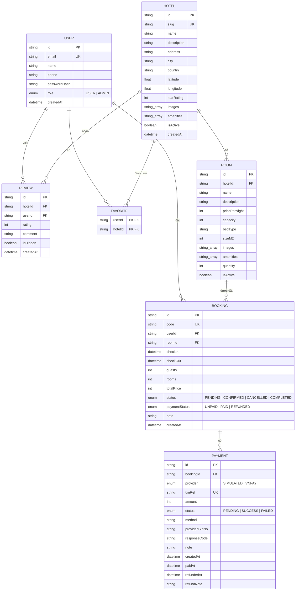

# Không Gian Số Stay – Hệ thống đặt phòng khách sạn

Đồ án thực tập tốt nghiệp tại **Công ty phần mềm Không Gian Số**. Ứng dụng web cho phép khách tìm kiếm khách sạn, đặt phòng, thanh toán (giả lập), đánh giá; quản trị viên quản lý khách sạn, phòng, đơn đặt phòng và người dùng.

## 1. Công nghệ

| Thành phần | Công nghệ |
|---|---|
| Giao diện + máy chủ | Next.js 16 (App Router, Cache Components), React 19, TypeScript |
| Giao diện | Tailwind CSS 4, lucide-react, font Be Vietnam Pro |
| Cơ sở dữ liệu | PostgreSQL 16 + Prisma ORM 6 |
| Xác thực | next-auth v5 (Credentials, phiên JWT), mật khẩu băm bcrypt |
| Kiểm tra dữ liệu | Zod |
| Thanh toán | VNPay (sandbox) hoặc cổng giả lập khi chưa cấu hình khóa |
| Email | Nodemailer (SMTP) |

> Dự án dùng phiên bản Next.js mới có khác biệt so với tài liệu cũ. Tài liệu đi kèm nằm trong `web/node_modules/next/dist/docs/` (xem `web/AGENTS.md`).

## 2. Chức năng

**Khách hàng**
- Trang chủ có ô tìm kiếm (điểm đến, ngày nhận/trả phòng, số khách), điểm đến phổ biến, khách sạn nổi bật.
- Trang kết quả `/hotels`: lọc theo thành phố, số khách, ngày trống, **khoảng giá, hạng sao, tiện nghi**; sắp xếp theo đề xuất / giá / đánh giá; thẻ lọc đang bật bấm × để bỏ từng điều kiện; trên điện thoại bộ lọc thu gọn.
- Trang chi tiết khách sạn: thư viện ảnh xem phóng to (phím mũi tên, thanh ảnh nhỏ), bản đồ vị trí (OpenStreetMap), tiện nghi, danh sách phòng kèm số phòng còn trống theo ngày chọn, đánh giá.
- Trang chủ có phần "Khách hàng nói gì" lấy từ các đánh giá tốt gần đây.
- Đăng ký, đăng nhập, đăng xuất; trang tài khoản.
- Đặt phòng → thanh toán (VNPay sandbox, hoặc giả lập khi chưa có khóa) → email xác nhận; xem lịch sử, hủy đơn (trước ngày nhận phòng).
- Yêu thích khách sạn (nút tim trên thẻ và trang chi tiết, trang `/favorites`).
- Viết hoặc sửa đánh giá sau khi đã hoàn tất kỳ lưu trú.

**Quản trị viên** (`/admin`)
- Tổng quan: bộ chỉ số theo kỳ 7/30/90 ngày (doanh thu, đơn mới, giá trị trung bình, tỷ lệ hủy, đơn chờ hoàn tiền), **biểu đồ doanh thu theo ngày**, **biểu đồ tỷ lệ lấp đầy các ngày tới**, khách sạn doanh thu cao nhất, đơn gần đây.
- Khách sạn: thêm, sửa, ẩn/hiện; loại phòng: thêm, sửa, ẩn/hiện; **tải ảnh lên** (JPEG/PNG/WebP), đặt ảnh bìa, xóa ảnh, hoặc thêm bằng URL.
- Đơn đặt phòng: lọc theo trạng thái, đổi trạng thái theo quy tắc, bộ lọc **Cần hoàn tiền** và nút **Đã hoàn tiền** kèm ghi chú.
- Đánh giá: **ẩn/hiện hoặc xóa** đánh giá không phù hợp; đánh giá bị ẩn không hiện công khai và không tính vào điểm trung bình.
- Người dùng: xem danh sách, cấp/thu hồi quyền quản trị.

## 3. Cài đặt và chạy

### 3.1. Yêu cầu
- Node.js **20.16 trở lên** và npm
- PostgreSQL 14 trở lên (cài sẵn trên máy **hoặc** dùng Docker Desktop)

### 3.2. Lấy mã nguồn và cài thư viện
```bash
cd web
npm install
```

### 3.3. Chuẩn bị cơ sở dữ liệu

**Cách A – dùng PostgreSQL có sẵn trên máy:** không cần tạo trước database `kgs_booking`, Prisma sẽ tự tạo khi migrate nếu tài khoản có quyền tạo database.

**Cách B – dùng Docker:** chạy ở thư mục gốc dự án (cùng cấp với `docker-compose.yml`), cần bật Docker Desktop trước.
```bash
docker compose up -d
```
Cách này tạo PostgreSQL ở cổng 5432 với tài khoản `kgs`. Nếu máy đã có PostgreSQL khác dùng cổng 5432 thì hãy tắt nó hoặc đổi cổng trong `docker-compose.yml` và `DATABASE_URL`.

### 3.4. Cấu hình biến môi trường
Sao chép `web/.env.example` thành `web/.env` rồi sửa:

| Biến | Ý nghĩa |
|---|---|
| `DATABASE_URL` | Chuỗi kết nối PostgreSQL. Mật khẩu có ký tự đặc biệt phải mã hóa URL (ví dụ `@` thành `%40`). |
| `AUTH_SECRET` | Khóa ký phiên đăng nhập. Tạo khóa mạnh bằng `npx auth secret` hoặc `openssl rand -base64 32`. |
| `AUTH_TRUST_HOST` | Đặt `true` khi chạy trên máy cục bộ ở chế độ production. |
| `UPLOAD_DIR` | (Không bắt buộc) Thư mục lưu ảnh quản trị viên tải lên. Mặc định `web/uploads`. |

Các biến cho VNPay và email nằm ở mục 6.

File `.env` không được đưa lên git.

### 3.5. Tạo bảng và dữ liệu mẫu
```bash
npx prisma migrate dev
npx prisma db seed
```
Lệnh seed **xóa toàn bộ dữ liệu cũ** rồi tạo lại: 2 tài khoản đăng nhập được, 5 tài khoản người đánh giá chỉ để hiển thị (mật khẩu ngẫu nhiên), 9 khách sạn ở 6 thành phố, 27 loại phòng, 27 đánh giá mẫu.

Nếu đã có dữ liệu và chỉ muốn thêm đánh giá mẫu đa dạng **mà không xóa gì**: `npx tsx prisma/seed-reviews.ts` (chạy lại nhiều lần vẫn an toàn).

### 3.6. Chạy ứng dụng
```bash
npm run dev          # phát triển, http://localhost:3000
```
hoặc bản production:
```bash
npm run build
npm start            # http://localhost:3000
```
> Không chạy `npm run dev` và `npm start` cùng lúc trong một thư mục: cả hai dùng chung thư mục `.next` và sẽ làm hỏng nhau (trang mất JavaScript, báo lỗi 404 các tệp tĩnh). Nếu bị, hãy tắt cả hai, xóa thư mục `web/.next` rồi build lại.

## 4. Tài khoản mẫu (chỉ dùng khi phát triển)

| Vai trò | Email | Mật khẩu |
|---|---|---|
| Quản trị viên | `admin@khongiansos.vn` | `Admin@123456` |
| Khách hàng | `khach@khongiansos.vn` | `Khach@123456` |

Các tài khoản này được khai báo ở `web/prisma/seed.ts`. **Phải đổi hoặc xóa trước khi triển khai thật.**

Để thử viết đánh giá bằng tài khoản khách: đặt một phòng, thanh toán, đăng nhập admin rồi chuyển đơn sang **Hoàn tất** tại `/admin/bookings` (chỉ chuyển được từ ngày nhận phòng trở đi, nên hãy chọn ngày nhận phòng là hôm nay).

## 5. Sơ đồ cơ sở dữ liệu



Ghi chú:
- `REVIEW` có ràng buộc duy nhất `(hotelId, userId)`: mỗi khách chỉ có một đánh giá cho một khách sạn.
- `FAVORITE` dùng khóa chính kép `(userId, hotelId)`.
- `PAYMENT`: mỗi lần thanh toán là một dòng riêng với `txnRef` duy nhất, dùng để đối soát và để xử lý kết quả từ cổng thanh toán đúng một lần.
- Xóa khách sạn sẽ xóa theo phòng, đánh giá, yêu thích (`onDelete: Cascade`). Đơn đặt phòng không bị xóa theo nên giao diện quản trị chỉ **ẩn** khách sạn, không xóa.
- Giá lưu theo đơn vị đồng (số nguyên), ngày nhận/trả phòng lưu ở dạng ngày UTC.

Có thể xem sơ đồ bằng VS Code (tiện ích Markdown Preview Mermaid Support), GitHub, hoặc dán khối `mermaid` vào <https://mermaid.live> để xuất ảnh đưa vào báo cáo.

## 6. Thanh toán VNPay và email xác nhận

**Mặc định (chưa điền khóa)**: dùng cổng thanh toán **giả lập**, không thu tiền thật, không cần thông tin thẻ; email bị bỏ qua nếu chưa cấu hình SMTP.

### 6.1. Bật VNPay sandbox
1. Đăng ký tài khoản thử nghiệm miễn phí tại <https://sandbox.vnpayment.vn/devreg/>. VNPay gửi email chứa **mã website (TmnCode)** và **khóa bí mật (HashSecret)**.
2. Điền vào `web/.env`: `VNPAY_TMN_CODE`, `VNPAY_HASH_SECRET`, và `APP_URL` (ví dụ `http://localhost:3000`). Khởi động lại ứng dụng.
3. Trang thanh toán tự chuyển sang VNPay. **Khi đã có khóa, cổng giả lập bị tắt** để không ai bỏ qua bước trả tiền.
4. Thử với thẻ ngân hàng thử nghiệm do VNPay công bố trong tài liệu sandbox (ví dụ ngân hàng NCB).

### 6.2. Cách hoạt động
- Khách bấm thanh toán → hệ thống tạo một dòng `Payment` rồi chuyển khách sang VNPay bằng địa chỉ có chữ ký **HMAC-SHA512** (số tiền × 100, giờ GMT+7, thời hạn thanh toán bằng thời hạn giữ phòng).
- VNPay đưa khách về `/api/payments/vnpay/return` và đồng thời gọi `/api/payments/vnpay/ipn` (máy chủ gọi máy chủ). **Cả hai đều kiểm tra chữ ký, mã giao dịch và số tiền**, rồi dùng chung một hàm xử lý an toàn khi gọi lặp: mỗi giao dịch chỉ được xác nhận đúng một lần, email chỉ gửi một lần.
- IPN trả về `RspCode` theo bảng của VNPay: `00` thành công, `01` không thấy đơn, `02` đã xác nhận, `04` sai số tiền, `97` sai chữ ký, `99` lỗi khác.
- Nếu tiền đã về nhưng không còn giữ được phòng (đơn đã hủy hoặc quá hạn giữ mà phòng đã hết): đơn chuyển **Đã hủy** nhưng giữ trạng thái **Đã thanh toán** kèm ghi chú trong `Payment`, để quản trị viên **hoàn tiền thủ công**.

### 6.3. Chạy trên máy cá nhân
VNPay chỉ gọi IPN vào địa chỉ công khai HTTPS nên **IPN không vào được `localhost`**. Khi chạy cục bộ, đơn vẫn được xác nhận nhờ trang quay về (đã kiểm tra chữ ký). Muốn thử cả IPN, dùng đường hầm như `ngrok http 3000` hoặc `cloudflared`, đặt `APP_URL` là địa chỉ đường hầm và khai báo IPN URL `…/api/payments/vnpay/ipn` trong trang quản lý sandbox của VNPay.

### 6.4. Email xác nhận
Điền `SMTP_HOST`, `SMTP_PORT`, `SMTP_USER`, `SMTP_PASS`, `EMAIL_FROM` trong `web/.env`. Ví dụ Gmail: `smtp.gmail.com`, cổng `587`, mật khẩu là **Mật khẩu ứng dụng** (bật xác minh 2 bước). Email gửi sau khi đơn chuyển sang **Đã xác nhận**; gửi lỗi chỉ ghi log, không làm hỏng đặt phòng. Mọi dữ liệu do khách nhập (tên, ghi chú) đều được thoát ký tự HTML.

### 6.5. Đã kiểm tra những gì (thanh toán)
- Chữ ký đối chiếu với thuật toán mẫu chính thức của VNPay (18 trường hợp: sai số tiền, sai khóa, thiếu chữ ký, tham số rỗng, ký tự đặc biệt…).
- Logic xác nhận trên cơ sở dữ liệu thật (16 trường hợp: thất bại, hủy, gọi lặp, hai yêu cầu đồng thời, đơn đã hủy, quá hạn giữ phòng).
- Các endpoint với dữ liệu đã ký, và email nhận được qua một máy chủ SMTP giả.
- **Chưa kiểm tra với tài khoản VNPay sandbox thật** (cần khóa của riêng bạn): trình duyệt đã tới được `sandbox.vnpayment.vn` và VNPay phản hồi "không tìm thấy website" với mã website giả, nghĩa là chuyển hướng hoạt động nhưng chữ ký chỉ được xác minh bằng cách đối chiếu mẫu.

## 7. Quy tắc nghiệp vụ chính

**Đặt phòng**
- Giá luôn được tính lại ở máy chủ (`đơn giá × số đêm × số phòng`), không tin giá từ trình duyệt.
- Thời gian ở từ 1 đến 30 đêm; ngày nhận phòng không được ở quá khứ; số khách không vượt `sức chứa × số phòng`.
- Kiểm tra phòng trống và tạo đơn trong **một giao dịch mức Serializable** để hai người đặt cùng lúc không vượt quá số phòng hiện có.
- Đơn mới ở trạng thái **Chờ thanh toán** và **giữ phòng 30 phút**; quá hạn mà chưa thanh toán thì không còn giữ phòng và không thanh toán được nữa.
- Thanh toán: nếu chưa cấu hình VNPay thì là **giả lập** (không thu tiền thật, không nhận thông tin thẻ); nếu đã cấu hình VNPay thì chỉ xác nhận khi cổng báo thành công (xem mục 6).
- Khách hủy đơn trước ngày nhận phòng. Đơn **chưa trả tiền thật** (giả lập) chuyển ngay sang Đã hoàn tiền; đơn **đã trả qua VNPay** giữ trạng thái **Chờ hoàn tiền** cho tới khi quản trị viên hoàn tiền (ngoài hệ thống) rồi bấm **Đã hoàn tiền** để ghi nhận kèm ghi chú.

**Quản trị đơn đặt phòng** – chuyển trạng thái một chiều:

| Từ | Được chuyển sang |
|---|---|
| Chờ thanh toán | Đã xác nhận (đánh dấu đã nhận tiền), Đã hủy |
| Đã xác nhận | Hoàn tất (từ ngày nhận phòng trở đi), Đã hủy |
| Đã hủy, Hoàn tất | không chuyển tiếp |

Khi xác nhận một đơn chờ đã quá hạn giữ phòng, hệ thống kiểm tra lại còn phòng hay không.

**Đánh giá**: chỉ khách có đơn **Hoàn tất** tại khách sạn đó mới được viết; gửi lại sẽ cập nhật đánh giá cũ. Điểm trung bình tính từ các đánh giá **đang hiển thị** (đánh giá bị quản trị viên ẩn không được tính; tác giả vẫn thấy thông báo đánh giá của mình đang bị ẩn).

**Số liệu báo cáo**: doanh thu = tổng tiền các đơn đã thanh toán và chưa hủy, tính theo ngày đặt (giờ Việt Nam); tỷ lệ lấp đầy = số phòng đã xác nhận hoặc đang giữ chỗ trên tổng số phòng đang bán, cho các ngày tới.

## 8. Bảo mật

- Mật khẩu băm bcrypt; đăng nhập so sánh trong thời gian không phụ thuộc việc email có tồn tại.
- Phiên là JWT mã hóa trong cookie; vai trò kiểm tra **ở từng trang và từng hành động quản trị** (`requireAdmin`), không chỉ dựa vào layout hay giao diện.
- Đường dẫn quay lại sau đăng nhập (`callbackUrl`) chỉ chấp nhận đường dẫn nội bộ, tránh chuyển hướng ra ngoài.
- Ảnh do quản trị nhập chỉ chấp nhận `https` từ `picsum.photos` và `images.unsplash.com` (khai báo ở `src/lib/image-hosts.ts`).
- Quản trị viên không đổi được vai trò của chính mình, tránh tự khóa quyền.
- Mọi dữ liệu nhập đều kiểm tra bằng Zod ở máy chủ.
- **Tải ảnh lên**: chỉ quản trị viên; kiểm tra nguồn yêu cầu (chống gửi chéo trang); giới hạn 5 MB/ảnh, 10 ảnh/lần, 30 MB/yêu cầu; **giải mã thật bằng `sharp`** để xác minh là JPEG/PNG/WebP (không tin tên tệp hay Content-Type), chặn ảnh "bom điểm ảnh" (trên 50 triệu điểm), thu nhỏ tối đa 2000px, **bỏ toàn bộ siêu dữ liệu (EXIF, vị trí)** và lưu lại dạng WebP nên mã nối đuôi hay tệp SVG/GIF/PHP đều bị loại. Tên tệp là mã ngẫu nhiên 32 ký tự; ảnh nằm **ngoài thư mục `public`** và được phục vụ qua một route chỉ nhận đúng dạng tên đó (không đọc được tệp ngoài thư mục ảnh).

## 9. Cấu trúc thư mục

```
Booking_Hotel/
├─ docker-compose.yml        PostgreSQL cho môi trường phát triển
└─ web/
   ├─ uploads/                ảnh quản trị viên tải lên (không đưa lên git)
   ├─ prisma/
   │  ├─ schema.prisma       mô hình dữ liệu
   │  ├─ migrations/         lịch sử migrate
   │  ├─ seed.ts             dữ liệu mẫu (xóa và tạo lại)
   │  └─ seed-reviews.ts     thêm đánh giá mẫu, không xóa dữ liệu
   └─ src/
      ├─ auth.ts             cấu hình next-auth
      ├─ app/
      │  ├─ page.tsx         trang chủ
      │  ├─ hotels/          tìm kiếm và chi tiết khách sạn
      │  ├─ book/            xác nhận đặt phòng
      │  ├─ bookings/        lịch sử, chi tiết, thanh toán
      │  ├─ favorites/       khách sạn yêu thích
      │  ├─ login/, register/, account/
      │  ├─ admin/           khu vực quản trị
      │  ├─ api/             next-auth, yêu thích, VNPay (return, ipn), tải ảnh lên và phục vụ ảnh
      │  └─ actions/         Server Actions (auth, booking, payment, engage, admin)
      ├─ components/         thành phần giao diện (admin/ cho quản trị)
      └─ lib/                truy vấn, quy tắc đặt phòng, phiên, định dạng, email
         └─ payments/        VNPay (ký, kiểm tra chữ ký) và xử lý kết quả thanh toán
```

## 10. Đã kiểm thử quản trị nâng cao

- **Tải ảnh lên (30 trường hợp)**: quyền (ẩn danh 401, khách thường 403, Origin lạ 403), ảnh hợp lệ JPEG/PNG/WebP, bỏ EXIF, thu nhỏ 4000×3000 về 2000×1500, từ chối PHP/SVG/GIF/HTML đội lốt ảnh, tệp rỗng/cắt cụt/"bom điểm ảnh"/quá 5 MB/11 tệp/quá 30 MB (413), mã nối đuôi ảnh bị loại, và các đường dẫn đọc tệp trái phép (`..%2f`, `..%5c`, tên sai dạng) đều 404.
- **Biểu đồ và chỉ số (40 trường hợp)**: dữ liệu thử có đáp án tính độc lập; từng cột doanh thu, tổng doanh thu, giá trị trung bình, tỷ lệ hủy, số đơn chờ hoàn tiền và tỷ lệ lấp đầy từng ngày đều khớp, ở cả kỳ 7 và 30 ngày; đơn đã hủy hoặc chưa thanh toán không vào doanh thu; khách thường và ẩn danh không thấy số liệu.
- **Hoàn tiền**: đơn đã hủy trả qua VNPay hiện "Chờ hoàn tiền"; bấm "Đã hoàn tiền" ghi `refundedAt` và ghi chú kèm tên quản trị viên.
- **Duyệt đánh giá**: ẩn làm đánh giá biến mất khỏi trang công khai và điểm trung bình tính lại ngay; hiện lại và xóa cũng cập nhật đúng.

## 11. Hạn chế và hướng phát triển

- VNPay mới ở chế độ sandbox, chưa kiểm tra với khóa thật; chưa có hoàn tiền tự động qua cổng (hoàn tiền là thao tác thủ công); chưa tích hợp MoMo.
- Ảnh khách sạn mẫu là ảnh ngẫu nhiên từ picsum.photos; quản trị viên có thể tải ảnh thật lên. Ảnh tải lên lưu **trên ổ đĩa của máy chủ** nên khi triển khai lên nền tảng không có ổ đĩa bền vững (ví dụ Vercel) cần chuyển sang kho lưu trữ đối tượng (S3, Cloudinary...); ảnh đã bị gỡ khỏi khách sạn vẫn còn tệp trên đĩa (chưa dọn tự động).
- Email mới có thư xác nhận đặt phòng (chưa có thư hủy phòng, nhắc lịch); chưa giới hạn số lần đăng nhập sai. Bản đồ cần truy cập được `openstreetmap.org` (nếu bị chặn sẽ hiện thông báo kèm liên kết).
- Chưa có ứng dụng di động (dự kiến React Native/Expo dùng chung API).
- Chưa có kiểm thử tự động; các luồng chính đã được kiểm tra thủ công.
- Trước khi triển khai thật: đổi `AUTH_SECRET`, xóa tài khoản mẫu, dùng HTTPS và PostgreSQL riêng có sao lưu.
