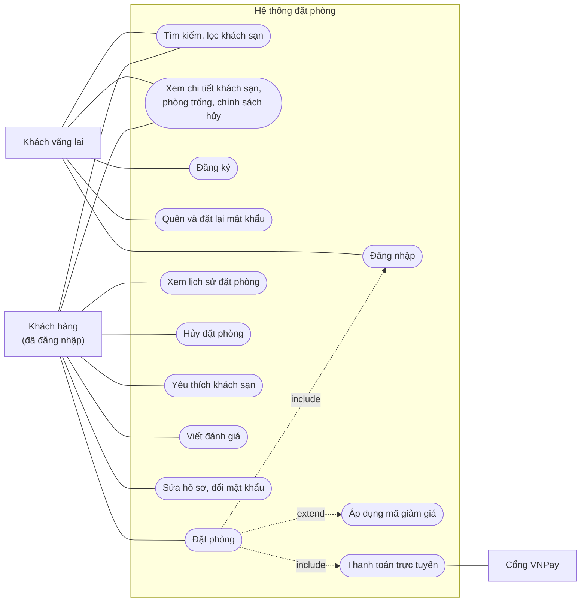
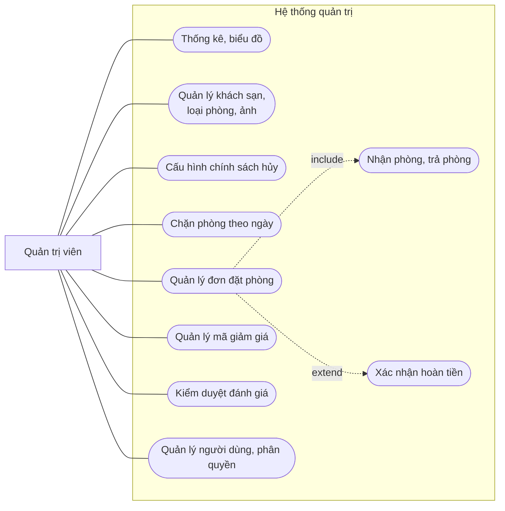
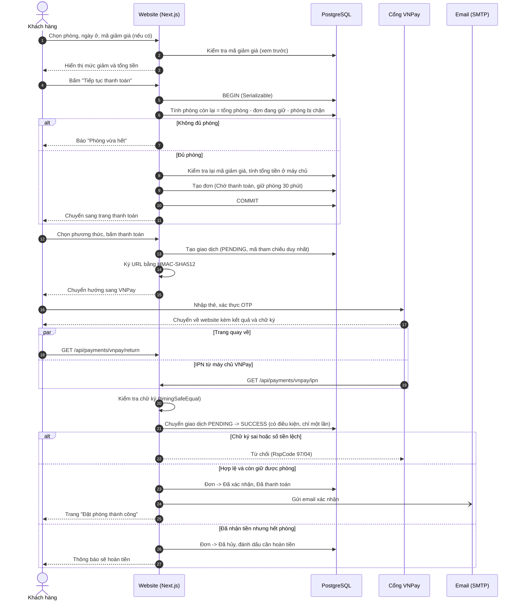
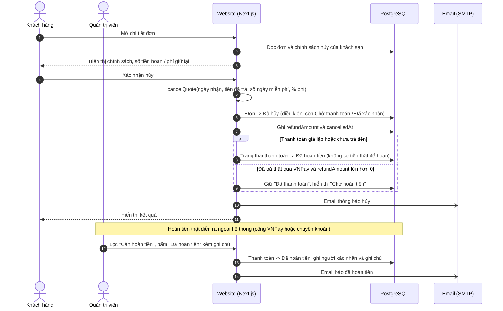
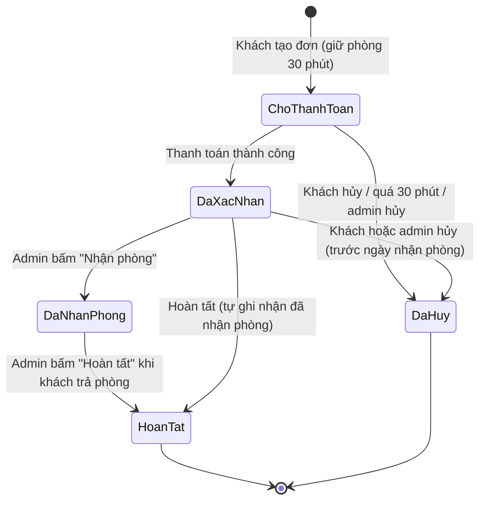
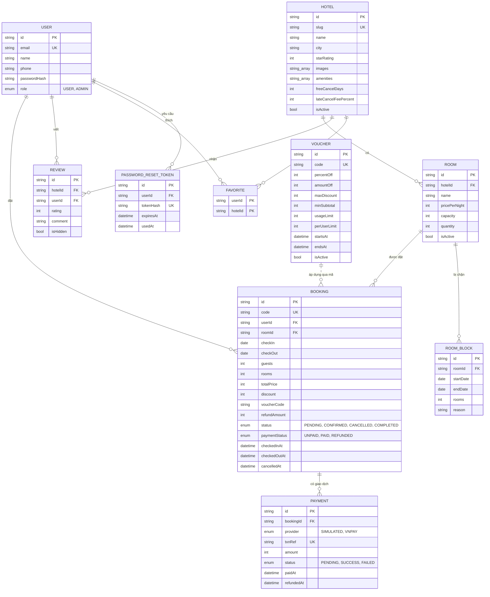
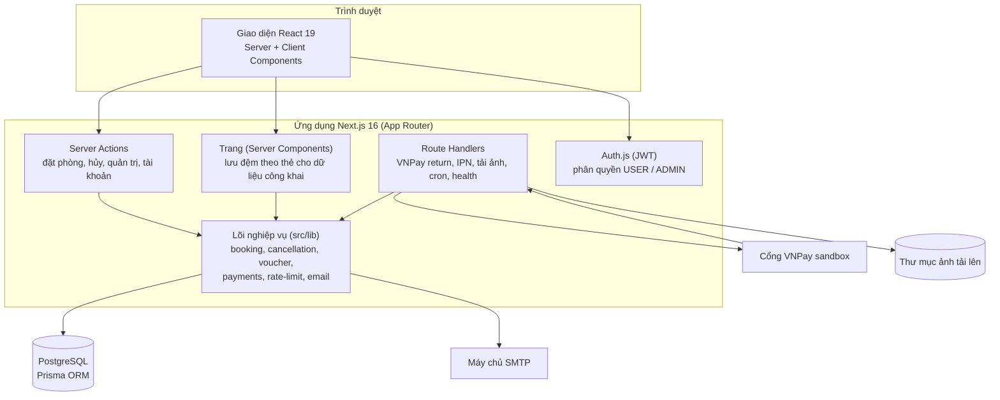

# Sơ đồ cho báo cáo – Không Gian Số Stay

Các sơ đồ dưới đây viết bằng **Mermaid**. GitHub và VS Code (có tiện ích xem Markdown Mermaid) hiển thị trực tiếp. Muốn chèn vào Word hoặc slide, dán mã vào https://mermaid.live rồi xuất ảnh PNG/SVG.

Danh sách:
1. Tác nhân và use case
2. Đặc tả use case chính (đặt phòng, thanh toán)
3. Sơ đồ tuần tự: đặt phòng và thanh toán VNPay
4. Sơ đồ tuần tự: hủy đơn và hoàn tiền
5. Sơ đồ trạng thái của đơn đặt phòng
6. Sơ đồ thực thể quan hệ (ER)
7. Kiến trúc tổng quan

---

## 1. Tác nhân và use case

Mermaid không có ký hiệu use case chuẩn UML nên dùng sơ đồ khối: hình chữ nhật bo tròn ngoài cùng bên trái là tác nhân, hình bầu dục là use case. Khi vẽ lại bằng công cụ UML (draw.io, StarUML), giữ nguyên nội dung. Sơ đồ tách làm hai để vừa một trang báo cáo.

### 1.1. Khách vãng lai và Khách hàng

### 1.2. Quản trị viên

Ghi chú: Quản trị viên kế thừa mọi quyền của Khách hàng (có thể tự đặt phòng); sơ đồ không vẽ để tránh rối. Use case "Hủy đặt phòng" của quản trị viên nằm trong "Quản lý đơn đặt phòng" (luôn hoàn đủ tiền).

---

## 2. Đặc tả use case chính

### UC-06 Đặt phòng

| Mục | Nội dung |
|---|---|
| Tác nhân | Khách hàng |
| Tiền điều kiện | Đã đăng nhập (nếu chưa, hệ thống chuyển sang trang đăng nhập rồi quay lại); đã chọn loại phòng, ngày nhận/trả (1–30 đêm, không ở quá khứ), số khách |
| Hậu điều kiện | Đơn ở trạng thái *Chờ thanh toán*, phòng được giữ 30 phút |
| Luồng chính | 1. Khách chọn phòng và ngày ở trang khách sạn. 2. Hệ thống hiển thị trang xác nhận kèm giá, số phòng còn lại. 3. Khách chọn số phòng, ghi yêu cầu, (tùy chọn) nhập mã giảm giá. 4. Hệ thống kiểm tra còn phòng, tính giá và giảm giá ở máy chủ, tạo đơn trong một giao dịch. 5. Chuyển sang trang thanh toán (UC-08). |
| Luồng thay thế | 3a. Mã giảm giá sai, hết hạn, hết lượt hoặc chưa đủ điều kiện: báo lỗi, khách đặt tiếp không cần mã. 4a. Phòng vừa hết hoặc số khách vượt sức chứa: báo lỗi, quay lại chọn phòng khác. 4b. Hai người đặt cùng lúc phòng cuối: một giao dịch bị từ chối, báo "hệ thống đang bận / phòng vừa hết". |
| Quy tắc | Giá do máy chủ tính; phòng bị quản trị chặn không đặt được; ngày trả phòng của khách này có thể là ngày nhận phòng của khách khác |

### UC-08 Thanh toán trực tuyến

| Mục | Nội dung |
|---|---|
| Tác nhân | Khách hàng; cổng VNPay |
| Tiền điều kiện | Đơn *Chờ thanh toán*, còn trong 30 phút giữ phòng |
| Hậu điều kiện | Thành công: đơn *Đã xác nhận / Đã thanh toán*, gửi email xác nhận. Thất bại hoặc hủy: đơn vẫn giữ phòng đến hết hạn, khách thanh toán lại được |
| Luồng chính | 1. Khách chọn phương thức, bấm thanh toán. 2. Hệ thống tạo giao dịch, sinh URL có chữ ký, chuyển khách sang VNPay. 3. Khách thanh toán tại VNPay. 4. VNPay báo kết quả về website (trang quay về và IPN). 5. Hệ thống kiểm tra chữ ký, đối chiếu số tiền, xác nhận đơn đúng một lần. |
| Luồng thay thế | 3a. Khách hủy hoặc thanh toán lỗi: ghi nhận giao dịch thất bại. 5a. Chữ ký sai hoặc số tiền lệch: từ chối, không xác nhận. 5b. Đã nhận tiền nhưng không còn giữ được phòng: đơn chuyển *Đã hủy* và đánh dấu cần hoàn tiền. \* Chưa cấu hình VNPay: dùng cổng giả lập (không thu tiền thật). |

### UC-10 Hủy đặt phòng

| Mục | Nội dung |
|---|---|
| Tác nhân | Khách hàng |
| Tiền điều kiện | Đơn *Chờ thanh toán* hoặc *Đã xác nhận*; chưa đến ngày nhận phòng; chưa nhận phòng thực tế |
| Hậu điều kiện | Đơn *Đã hủy*; nếu đã thanh toán, số tiền hoàn được tính và lưu vào đơn |
| Luồng chính | 1. Khách mở chi tiết đơn, bấm *Hủy*. 2. Hệ thống hiện số tiền hoàn hoặc phí giữ lại theo chính sách của khách sạn. 3. Khách xác nhận. 4. Hệ thống hủy đơn, ghi `refundAmount`, gửi email thông báo. |
| Quy tắc | Hủy trước ngày nhận phòng ít nhất N ngày: hoàn đủ; muộn hơn: giữ X% số tiền đã trả; đơn chưa thanh toán hủy không mất phí; quản trị viên hủy thì luôn hoàn đủ |

---

## 3. Sơ đồ tuần tự: đặt phòng và thanh toán VNPay

Điểm cần nhấn mạnh khi báo cáo: bước 5–8 nằm trong một **giao dịch Serializable** nên không thể đặt trùng phòng; bước `PENDING -> SUCCESS` có điều kiện nên trang quay về và IPN chạy đồng thời vẫn chỉ xác nhận **một lần**.

---

## 4. Sơ đồ tuần tự: hủy đơn và hoàn tiền

---

## 5. Sơ đồ trạng thái của đơn đặt phòng

Ghi chú: trong cơ sở dữ liệu, *Đã nhận phòng* không phải một trạng thái riêng mà là đơn `CONFIRMED` có `checkedInAt`; đơn đã nhận phòng không hủy được. Với đơn đã hủy mà đã thanh toán, trạng thái thanh toán đi tiếp theo nhánh riêng: *Đã thanh toán → Chờ hoàn tiền → Đã hoàn tiền*.

---

## 6. Sơ đồ thực thể quan hệ (ER)

Ghi chú: `Booking.voucherCode` lưu mã dạng chuỗi (không khóa ngoại) để đổi hoặc xóa voucher không làm hỏng đơn cũ; vì vậy quan hệ với `VOUCHER` vẽ nét đứt. Bảng `RateLimit` (bộ đếm giới hạn đăng nhập/đăng ký/đổi mật khẩu) là bảng kỹ thuật, không có quan hệ nên không vẽ.

---

## 7. Kiến trúc tổng quan

